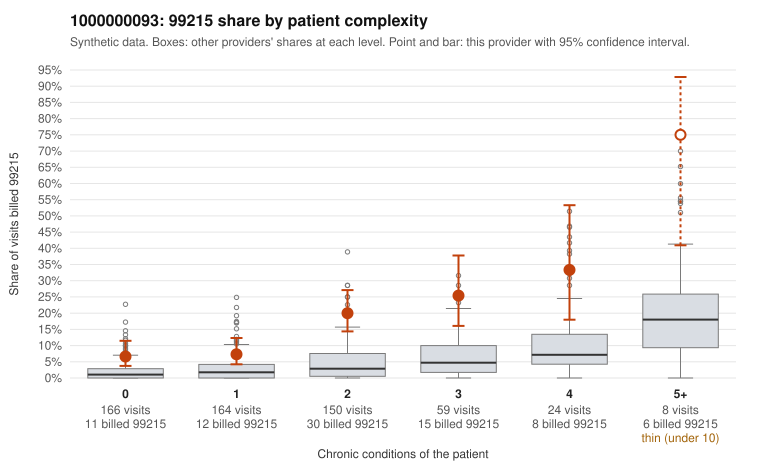

# 1000000093: Provider 1000000093 bills 99215 well above expectation in every complexity tier, including simple acute visits, but too few charts came back to confirm or refute upcoding.

**Leaning (advisory):** Inconclusive

## Why

1000000093 billed 99215 on 14.4% of 571 claims against an expected 2.7% given patient complexity (risk-adjusted score 6.40; plain z-score vs peers 1.71). 28% of this provider's 99215 claims were on patients with 0 or 1 chronic conditions. Records came back for 19 claims. Of 2 documented 99215 claims, 0 (0%) were documented below the billed level, against 14% for the comparison providers. 1 of 12 notes claiming moderate-or-higher data reviewed had no lab or test line on the claim. The billing pattern leans toward upcoding rather than a sicker panel. The 99215 share runs roughly two to four times the all-provider rate within every condition-count tier, including patients with no chronic conditions, so panel complexity does not explain the excess. The sampled low-complexity 99215 claims include rash, upper respiratory infection and follow-up-only visits (for example C0048909, C0049012, C0049082, C0049171), which are hard to square with high-level visits, while the high-complexity examples such as C0048901 and C0049386 look plausible. The documentation cannot settle the question: only 2 documented 99215 claims came back. Both supported the billed level, but one of them, C0048889, is a zero-condition rash visit documented as high MDM with no time recorded, so a reviewer should check whether that note is templated or cloned. As a first step, request charts specifically for the low-complexity 99215 claims and for a sample of the heavily used 99214 claims, then compare the documented MDM to the diagnoses on each claim. Examples: C0048876: billed 99215, patient aged 46 with 1 chronic condition(s) (type 2 diabetes). C0048877: billed 99215, patient aged 24 with 1 chronic condition(s) (COPD).

## Evidence chart

## Cited claims

`C0048876`, `C0048877`

## Suggested next steps

- Request records for a larger sample of this provider's 99214 and 99215 claims; what came back is too thin to judge.
- Re-screen the provider once the records arrive.

---
Citations checked: 2/2 valid. Synthetic data. The leaning is advisory; the flag comes from the statistical screen, and no clinical documentation is available beyond the sampled records-review facts shown in the packet.
