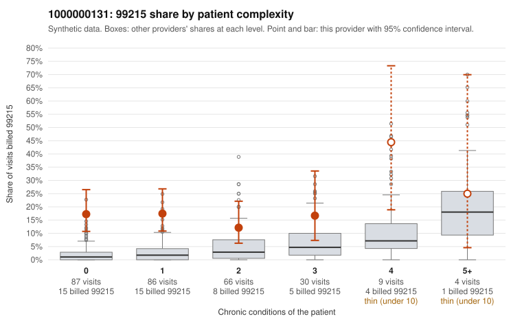

# 1000000131: Provider 1000000131 bills 99215 far above the complexity-adjusted expectation, concentrated on patients with few or no chronic conditions, but records came back for too few claims to confirm or rule out upcoding.

**Leaning (advisory):** Inconclusive

## Why

1000000131 billed 99215 on 17.0% of 282 claims against an expected 2.6% given patient complexity (risk-adjusted score 5.63; plain z-score vs peers 2.19). 62% of this provider's 99215 claims were on patients with 0 or 1 chronic conditions. Records came back for 16 claims. Of 3 documented 99215 claims, 0 (0%) were documented below the billed level, against 14% for the comparison providers. 0 of 11 notes claiming moderate-or-higher data reviewed had no lab or test line on the claim. The billing pattern is consistent with upcoding. The elevated 99215 share is nearly flat across the 0- and 1-condition strata, where peers rarely bill 99215. The sampled low-complexity 99215 claims carry routine diagnoses such as low back pain (C0069189, C0069208), URI (C0069078), rash (C0069136) and follow-up Z09 (C0069126), which would not ordinarily support high-complexity visits. Against that, the three documented 99215 claims all supported the billed level (C0069013 and C0069053 are low-complexity claims documented as high MDM). No data-reviewed notes lacked a corresponding lab or test line, so there is no sign of cloned documentation. Three documented 99215s are far too few to outweigh the claims pattern or to establish support, so the reviewer should first request charts for a larger sample of the low-complexity 99215 claims, prioritizing simple-diagnosis visits like those listed above, and check whether the documented MDM and time are internally consistent with the presenting problem. Examples: C0069130: billed 99214; documented MDM level low, 27 minutes. C0069007: billed 99215, patient aged 28 with 1 chronic condition(s) (obesity). C0069013: billed 99215, patient aged 43 with 0 chronic condition(s); documented MDM level high, 47 minutes.

## Evidence chart

## Cited claims

`C0069130`, `C0069007`, `C0069013`

## Suggested next steps

- Request records for a larger sample of this provider's 99214 and 99215 claims; what came back is too thin to judge.
- Re-screen the provider once the records arrive.

---
Citations checked: 3/3 valid. Synthetic data. The leaning is advisory; the flag comes from the statistical screen, and no clinical documentation is available beyond the sampled records-review facts shown in the packet.
