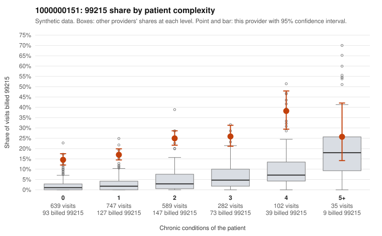

# 1000000151: Provider 1000000151 bills 99215 well above expectation in every complexity tier, including patients with no chronic conditions, but the records review is too thin to confirm or refute the billed levels.

**Leaning (advisory):** Pattern consistent with upcoding

## Why

1000000151 billed 99215 on 20.4% of 2,394 claims against an expected 2.7% given patient complexity (risk-adjusted score 19.78; plain z-score vs peers 2.80). 45% of this provider's 99215 claims were on patients with 0 or 1 chronic conditions. Records came back for 22 claims. Of 1 documented 99215 claims, 0 (0%) were documented below the billed level, against 14% for the comparison providers. 4 of 18 notes claiming moderate-or-higher data reviewed had no lab or test line on the claim. The claims pattern is consistent with upcoding rather than a sicker panel. The excess 99215 rate holds across all complexity strata instead of concentrating in complex patients, and nearly half of the 99215s fall on patients with 0 or 1 chronic conditions. The sampled low-complexity 99215s often carry routine diagnoses such as urinary infection, upper respiratory infection, rash or follow-up codes (e.g., C0077210, C0077478, C0078665, C0076525), which rarely support high-complexity decision-making. The high-complexity samples (e.g., C0076702, C0078474) do look like plausible 99215s. Documentation is too thin to judge: only one 99215 chart came back (C0077013, supported at high MDM), and the clean result on 99213 and 99214 charts cannot be generalized given the small sample. The 4 notes claiming moderate-or-higher data review with no lab or test line on the claim are only weak evidence of inflated documentation. A reviewer should first request charts for the low-complexity 99215 claims, prioritizing the zero-condition acute visits, and check whether the notes show real high-level MDM or time, or templated language. Examples: C0076320: billed 99215, patient aged 38 with 1 chronic condition(s) (type 2 diabetes). C0076525: billed 99215, patient aged 48 with 0 chronic condition(s). C0076564: billed 99215, patient aged 31 with 1 chronic condition(s) (type 2 diabetes).

## Evidence chart

## Cited claims

`C0076320`, `C0076525`, `C0076564`

## Suggested next steps

- Request the full records for the cited claims and have a certified coder re-score each against current E/M documentation rules (medical decision making or total time).
- If the re-scoring confirms the pattern, use the sampling plan in the recovery packet to review a statistical sample of this provider's 99215 claims.
- Check whether notes for the cited claims look copied forward, and whether documented minutes repeat from visit to visit.

---
Citations checked: 3/3 valid. Synthetic data. The leaning is advisory; the flag comes from the statistical screen, and no clinical documentation is available beyond the sampled records-review facts shown in the packet.
