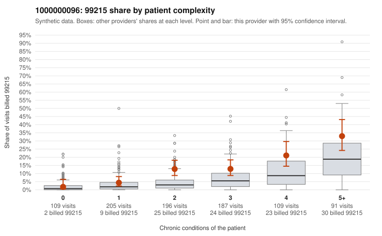

# 1000000096: Provider 1000000096's 99215 excess sits mainly in moderately complex patients rather than low-complexity ones, but the few charts returned are too thin to tell upcoding from a sicker panel.

**Leaning (advisory):** Inconclusive

## Why

1000000096 billed 99215 on 12.6% of 897 claims against an expected 5.1% given patient complexity (risk-adjusted score 5.00; plain z-score vs peers 1.50). 10% of this provider's 99215 claims were on patients with 0 or 1 chronic conditions. Records came back for 15 claims. Of 3 documented 99215 claims, 0 (0%) were documented below the billed level, against 0% for the comparison providers. 0 of 8 notes claiming moderate-or-higher data reviewed had no lab or test line on the claim. The elevated 99215 rate is not driven by low-complexity visits. At 0–1 conditions this provider tracks peers, and most of the excess falls on patients with 2–3 conditions, where the 99215 share runs well above the all-provider rate. That pattern could reflect a genuinely sicker panel or level inflation in the middle of the complexity range. The documentation leans in different directions. All three documented 99215s (C0053635, C0054199, C0054442) support high MDM, and the data-reviewed notes all have test lines on the claim. However, 3 of 7 documented 99214s came back at low MDM (e.g., C0053625, C0054102, C0054446), well above the comparison rate. With only 15 charts, that is a weak but notable signal, especially given how heavily this provider bills 99214. A reviewer should first request more charts, prioritizing 99214s and 99215s on 2–3 condition patients, along with low-acuity 99215s such as C0054144 (acute URI, no chronic conditions) and C0054435 (UTI in an 18-year-old). Examples: C0053625: billed 99214; documented MDM level low, minutes not recorded. C0053695: billed 99213; documented MDM level straightforward, minutes not recorded. C0053518: billed 99215, patient aged 83 with 1 chronic condition(s) (hyperlipidemia). C0053531: billed 99215, patient aged 50 with 1 chronic condition(s) (atrial fibrillation).

## Evidence chart

## Cited claims

`C0053625`, `C0053695`, `C0053518`, `C0053531`

## Suggested next steps

- Request records for a larger sample of this provider's 99214 and 99215 claims; what came back is too thin to judge.
- Re-screen the provider once the records arrive.

---
Citations checked: 4/4 valid. Synthetic data. The leaning is advisory; the flag comes from the statistical screen, and no clinical documentation is available beyond the sampled records-review facts shown in the packet.
