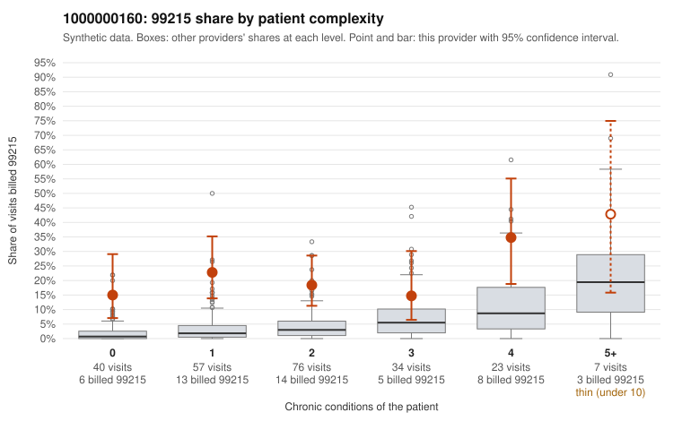

# 1000000160: 1000000160: 4 of 12 documented 99214 and 99215 claims (33%) are documented below the billed level

**Leaning (advisory):** Pattern consistent with upcoding

## Why

1000000160 billed 99215 on 20.7% of 237 claims against an expected 3.7% given patient complexity (risk-adjusted score 6.63; plain z-score vs peers 3.06). 39% of this provider's 99215 claims were on patients with 0 or 1 chronic conditions. Records came back for 15 claims. Of 3 documented 99215 claims, 2 (67%) were documented below the billed level, against 0% for the comparison providers. 1 of 10 notes claiming moderate-or-higher data reviewed had no lab or test line on the claim. This pattern is consistent with upcoding. It is a reason to review the records, not a finding. Examples: C0081766: billed 99215; documented MDM level moderate, minutes not recorded. C0081802: billed 99215, patient aged 51 with 0 chronic condition(s); documented MDM level moderate, 38 minutes. C0081673: billed 99215, patient aged 45 with 1 chronic condition(s) (hypertension). C0081678: billed 99215, patient aged 52 with 1 chronic condition(s) (asthma). C0081694: billed 99215, patient aged 63 with 0 chronic condition(s).

## Evidence chart

## Cited claims

`C0081766`, `C0081802`, `C0081673`, `C0081678`, `C0081694`

## Suggested next steps

- Request the full records for the cited claims and have a certified coder re-score each against current E/M documentation rules (medical decision making or total time).
- If the re-scoring confirms the pattern, use the sampling plan in the recovery packet to review a statistical sample of this provider's 99215 claims.
- Check whether notes for the cited claims look copied forward, and whether documented minutes repeat from visit to visit.

---
Citations checked: 5/5 valid. Synthetic data. The leaning is advisory; the flag comes from the statistical screen, and no clinical documentation is available beyond the sampled records-review facts shown in the packet.
