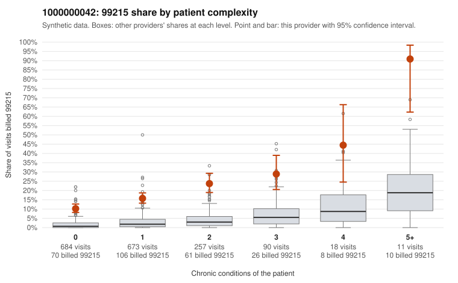

# Payment Integrity dossier: 1000000042

> Draft for human review. Statistical and records-sample evidence only; not a finding. Compliance or legal review is needed before any provider contact, notice or recoupment.

## Provider overview

| | |
|---|---|
| Specialty / state | Family Practice, GA (synthetic) |
| Claims / patients | 1,733 / 859 |
| Billed mix (99211 to 99215) | 4 / 9 / 413 / 1,026 / 281 |
| 99215 share | 16.2% |
| Expected 99215 share given patient complexity | 2.2% |
| Screen scores | z vs peers 2.20; risk-adjusted 18.83; flagged by suspicion>=5 |

## Case summary (advisory)

**Provider 1000000042's 99215 share is elevated across every complexity stratum and concentrated on 0-1 condition patients, which is consistent with upcoding, but documentation is too thin to confirm.**

Leaning: pattern consistent with upcoding. Citations checked: 4/4 valid.

1000000042 billed 99215 on 16.2% of 1,733 claims against an expected 2.2% given patient complexity (risk-adjusted score 18.83; plain z-score vs peers 2.20). 63% of this provider's 99215 claims were on patients with 0 or 1 chronic conditions. Records came back for 16 claims. Of 2 documented 99215 claims, 0 (0%) were documented below the billed level, against 0% for the comparison providers. 0 of 9 notes claiming moderate-or-higher data reviewed had no lab or test line on the claim. The billing pattern, not the charts, drives this leaning. The 99215 share runs well above the all-provider rate in every complexity band, including patients with no chronic conditions. Most 99215s fall on low-complexity patients, for example single-complaint visits coded R21, M54.50 or N39.0 (C0025265, C0025592, C0026866), where a high-complexity visit would be unusual. The provider does treat some genuinely complex patients (C0025391, C0025824), but their 99215 share is elevated even there, so panel acuity alone does not explain the excess. The documentation neither supports nor undercuts this: only 2 documented 99215 claims came back, both supported (C0025546, C0026261), and the data-reviewed check raised no flags. That is far too few charts to judge. A reviewer should first request records specifically for the low-complexity 99215 claims listed here and compare the documented MDM and time against the billed level. Examples: C0025530: billed 99214; documented MDM level low, 21 minutes. C0025265: billed 99215, patient aged 44 with 0 chronic condition(s). C0025296: billed 99215, patient aged 68 with 1 chronic condition(s) (type 2 diabetes). C0025385: billed 99215, patient aged 25 with 0 chronic condition(s).

## Evidence chart

## Records-review sample so far

Documentation is on file for 16 claims (1% of this provider's claims).

| Billed | Documented | Documentation below billed level | Rate | All-provider rate |
|---|---|---|---|---|
| 99213 | 4 | 0 | 0.0% | 4.7% |
| 99214 | 10 | 1 | 10.0% | 3.7% |
| 99215 | 2 | 0 | 0.0% | 0.0% |

## Recommended next steps for Payment Integrity

1. Request records for the sampled claims in `record_request_list.csv` (55 claims across 99215).
2. Review the records against E/M documentation rules and record the supported level for each claim.
3. Run the overpayment estimator on the reviewed sample (`sampling_plan.md` explains how).
4. Notice, appeal rights, recoupment, education or corrective action, and any referral are decisions for the PI team, compliance and counsel. Nothing here drafts those.

Suggested follow-ups from the case summary:

- Request the full records for the cited claims and have a certified coder re-score each against current E/M documentation rules (medical decision making or total time).
- If the re-scoring confirms the pattern, use the sampling plan in the recovery packet to review a statistical sample of this provider's 99215 claims.
- Check whether notes for the cited claims look copied forward, and whether documented minutes repeat from visit to visit.

## Limits

- Synthetic data; no real claims or providers.
- The leaning is advisory. The flag comes from the statistical screen; the summary explains it.
- The records-review sample is partial and was simulated for this project.
- Allowed amounts are GA Family Practice averages from a public CMS file, not this provider's actual payments.
