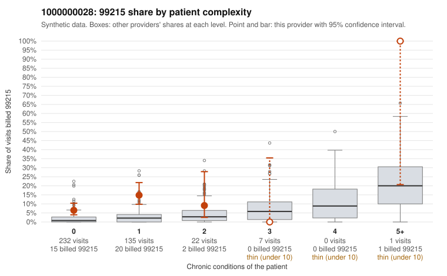

# 1000000028: High 99215 rate concentrated on 0–1 condition patients suggests possible upcoding, but only two documented 99215 claims leaves the records too thin to confirm.

**Leaning (advisory):** Inconclusive

## Why

1000000028 billed 99215 on 9.6% of 397 claims against an expected 1.8% given patient complexity (risk-adjusted score 5.15; plain z-score vs peers 0.81). 92% of this provider's 99215 claims were on patients with 0 or 1 chronic conditions. Records came back for 30 claims. Of 2 documented 99215 claims, 0 (0%) were documented below the billed level, against 3% for the comparison providers. 1 of 15 notes claiming moderate-or-higher data reviewed had no lab or test line on the claim. The billing mix is the main concern. This provider's 99215 share runs well above what the panel's complexity predicts, and nearly all sampled 99215 claims are on patients with zero or one chronic condition. Many of these carry simple diagnoses such as R10.9, N39.0, J06.9 or R21 (e.g., C0011920, C0012101, C0012175), which is the pattern consistent with upcoding rather than a sicker panel. Against that, the records review found no claims documented below the billed level at any level, and both documented 99215 claims (C0012074, C0012242) were documented at high MDM, although C0012074 has no minutes recorded. Only one note with moderate-plus data reviewed lacked a lab or test line, so there is little sign of cloned documentation. Two documented 99215s cannot carry a conclusion, so the reviewer should first request charts specifically for the low-complexity 99215 claims listed in the packet and check whether the documented MDM genuinely supports high complexity for those presenting problems. Examples: C0011910: billed 99215, patient aged 30 with 0 chronic condition(s). C0011917: billed 99215, patient aged 45 with 1 chronic condition(s) (osteoarthritis).

## Evidence chart

## Cited claims

`C0011910`, `C0011917`

## Suggested next steps

- Request records for a larger sample of this provider's 99214 and 99215 claims; what came back is too thin to judge.
- Re-screen the provider once the records arrive.

---
Citations checked: 2/2 valid. Synthetic data. The leaning is advisory; the flag comes from the statistical screen, and no clinical documentation is available beyond the sampled records-review facts shown in the packet.
