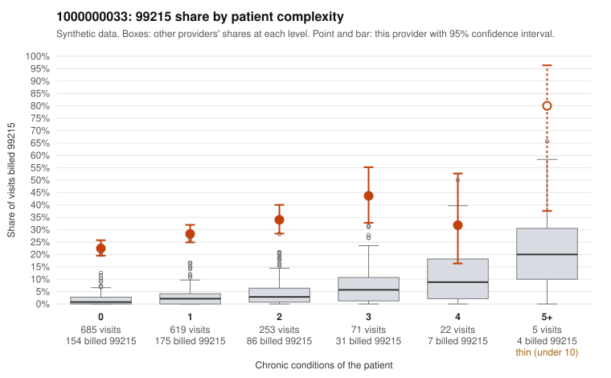

# 1000000033: 1000000033: 7 of 8 documented 99215 claims (88%) are documented below the billed level

**Leaning (advisory):** Pattern consistent with upcoding

## Why

1000000033 billed 99215 on 27.6% of 1,655 claims against an expected 2.2% given patient complexity (risk-adjusted score 31.01; plain z-score vs peers 3.84). 72% of this provider's 99215 claims were on patients with 0 or 1 chronic conditions. Records came back for 30 claims. Of 8 documented 99215 claims, 7 (88%) were documented below the billed level, against 3% for the comparison providers. 0 of 19 notes claiming moderate-or-higher data reviewed had no lab or test line on the claim. This pattern is consistent with upcoding. It is a reason to review the records, not a finding. Examples: C0014070: billed 99215; documented MDM level moderate, 36 minutes. C0014152: billed 99215; documented MDM level moderate, minutes not recorded. C0014357: billed 99215; documented MDM level moderate, minutes not recorded. C0013976: billed 99215, patient aged 59 with 1 chronic condition(s) (hyperlipidemia). C0014021: billed 99215, patient aged 74 with 1 chronic condition(s) (atrial fibrillation). C0014053: billed 99215, patient aged 50 with 0 chronic condition(s).

## Evidence chart

## Cited claims

`C0014070`, `C0014152`, `C0014357`, `C0013976`, `C0014021`, `C0014053`

## Suggested next steps

- Request the full records for the cited claims and have a certified coder re-score each against current E/M documentation rules (medical decision making or total time).
- If the re-scoring confirms the pattern, use the sampling plan in the recovery packet to review a statistical sample of this provider's 99215 claims.
- Check whether notes for the cited claims look copied forward, and whether documented minutes repeat from visit to visit.

---
Citations checked: 6/6 valid. Synthetic data. The leaning is advisory; the flag comes from the statistical screen, and no clinical documentation is available beyond the sampled records-review facts shown in the packet.
