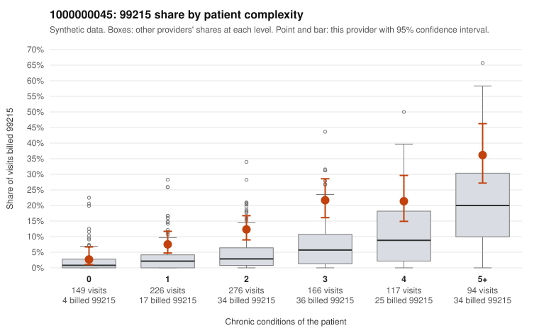

# 1000000045: Provider 1000000045 bills 99215 well above expectation across nearly every complexity tier, but the few returned charts support the billed level, so the evidence does not yet settle upcoding versus a sicker panel.

**Leaning (advisory):** Inconclusive

## Why

1000000045 billed 99215 on 14.6% of 1,028 claims against an expected 4.9% given patient complexity (risk-adjusted score 6.52; plain z-score vs peers 1.65). 14% of this provider's 99215 claims were on patients with 0 or 1 chronic conditions. Records came back for 30 claims. Of 6 documented 99215 claims, 0 (0%) were documented below the billed level, against 3% for the comparison providers. 1 of 20 notes claiming moderate-or-higher data reviewed had no lab or test line on the claim. The elevation is not explained by panel acuity alone: the 99215 share runs roughly two to three times the all-provider share among patients with 1 to 4 conditions, and a sample of low-complexity 99215 claims (e.g., C0022095 and C0022705 for uncomplicated hypertension, C0022613 and C0022931 for a urinary diagnosis with no chronic conditions) is the pattern of concern. Against that, all 6 documented 99215 claims were supported, though six charts are too thin to clear the provider. Two of the supported notes deserve scrutiny: C0022706 and C0022782 are 0-condition patients seen for an upper respiratory infection (J06.9) yet documented at high MDM with no minutes recorded, which may point to templated or inflated notes rather than a truly complex visit. The data-reviewed cross-check flagged only 1 of 20 notes, which is weak evidence either way. A reviewer should first request full charts for the low-complexity 99215 claims listed in the packet, prioritizing the acute-only visits, and compare note text across patients for cloned MDM language. Examples: C0022751: billed 99214; documented MDM level low, 28 minutes. C0022095: billed 99215, patient aged 57 with 1 chronic condition(s) (hypertension). C0022127: billed 99215, patient aged 29 with 1 chronic condition(s) (hyperlipidemia).

## Evidence chart

## Cited claims

`C0022751`, `C0022095`, `C0022127`

## Suggested next steps

- Request records for a larger sample of this provider's 99214 and 99215 claims; what came back is too thin to judge.
- Re-screen the provider once the records arrive.

---
Citations checked: 3/3 valid. Synthetic data. The leaning is advisory; the flag comes from the statistical screen, and no clinical documentation is available beyond the sampled records-review facts shown in the packet.
