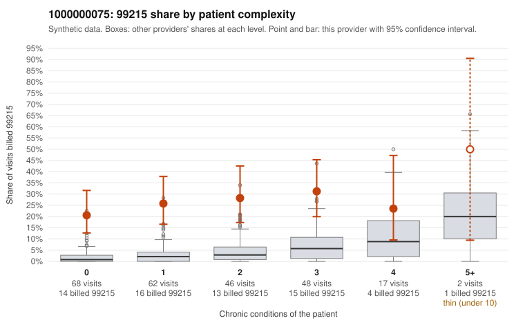

# 1000000075: Provider 1000000075 bills 99215 far above expectation, with nearly half on low-complexity patients, but the small set of returned charts mostly supports the billed level, so the picture is mixed.

**Leaning (advisory):** Inconclusive

## Why

1000000075 billed 99215 on 25.9% of 243 claims against an expected 3.2% given patient complexity (risk-adjusted score 8.89; plain z-score vs peers 3.56). 48% of this provider's 99215 claims were on patients with 0 or 1 chronic conditions. Records came back for 30 claims. Of 11 documented 99215 claims, 1 (9%) were documented below the billed level, against 3% for the comparison providers. 7 of 25 notes claiming moderate-or-higher data reviewed had no lab or test line on the claim. The claims pattern is concerning. The 99215 excess holds in every complexity stratum, including patients with no chronic conditions. The sampled low-complexity 99215s carry simple diagnoses such as low back pain, abdominal pain, rash and URI (e.g., C0035757, C0035769, C0035773), which is not what a sicker panel would look like. The documentation points the other way: only 1 of the 11 documented 99215s fell below the billed level (C0035831), so a records review alone does not show unsupported billing. That is too few charts to rule upcoding in or out. Some notes may be inflated rather than accurate: several supported 99215s record high MDM on minimal-complexity visits (C0035946 abdominal pain, C0035994 Z09 follow-up, C0035895 asthma), most show no minutes, and some notes claim moderate-or-higher data review with no lab or test line on the claim. A reviewer should first pull full charts for the low-complexity 99215s, especially those already documented as high MDM. Check whether the MDM narrative is templated or cloned across patients and whether the reviewed data actually exists. Then expand the records request beyond the current small sample. Examples: C0035831: billed 99215; documented MDM level moderate, minutes not recorded. C0035757: billed 99215, patient aged 57 with 0 chronic condition(s). C0035769: billed 99215, patient aged 38 with 0 chronic condition(s).

## Evidence chart

## Cited claims

`C0035831`, `C0035757`, `C0035769`

## Suggested next steps

- Request records for a larger sample of this provider's 99214 and 99215 claims; what came back is too thin to judge.
- Re-screen the provider once the records arrive.

---
Citations checked: 3/3 valid. Synthetic data. The leaning is advisory; the flag comes from the statistical screen, and no clinical documentation is available beyond the sampled records-review facts shown in the packet.
