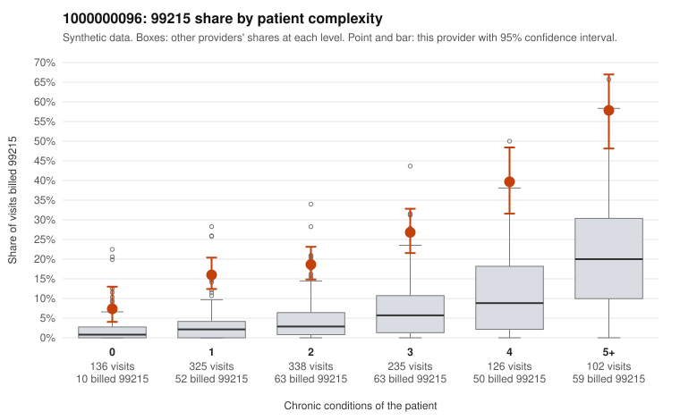

# 1000000096: Provider 1000000096 bills 99215 well above expected in every complexity band, including low-acuity visits, but the few charts returned all support the billed level, so the evidence is mixed.

**Leaning (advisory):** Inconclusive

## Why

1000000096 billed 99215 on 23.5% of 1,262 claims against an expected 4.7% given patient complexity (risk-adjusted score 14.12; plain z-score vs peers 3.15). 21% of this provider's 99215 claims were on patients with 0 or 1 chronic conditions. Records came back for 30 claims. Of 6 documented 99215 claims, 0 (0%) were documented below the billed level, against 3% for the comparison providers. 2 of 21 notes claiming moderate-or-higher data reviewed had no lab or test line on the claim. The 99215 share runs above the all-provider rate in every complexity band, not just among multi-morbid patients, which a sicker panel alone would not explain. Sampled low-complexity 99215s carry low-acuity diagnoses, such as rash on C0049347, upper respiratory infection on C0049666, follow-up on C0049758 and abdominal pain on C0049181, and that pattern is consistent with upcoding. Against this, every documented 99215 (for example C0049728 and C0049818) shows high MDM with substantial minutes. However, only 6 documented 99215s against nearly 300 billed is too thin to clear the pattern. The two moderate-plus data-reviewed notes with no lab or test line are weak evidence of templated or inflated notes, not proof. The reviewer should first request charts targeted at the low-complexity 99215s listed here, checking whether the notes are cloned or templated, and should also review why 99214 dominates the overall code mix. Examples: C0049072: billed 99215, patient aged 31 with 1 chronic condition(s) (depression). C0049121: billed 99215, patient aged 41 with 1 chronic condition(s) (hyperlipidemia).

## Evidence chart

## Cited claims

`C0049072`, `C0049121`

## Suggested next steps

- Request records for a larger sample of this provider's 99214 and 99215 claims; what came back is too thin to judge.
- Re-screen the provider once the records arrive.

---
Citations checked: 2/2 valid. Synthetic data. The leaning is advisory; the flag comes from the statistical screen, and no clinical documentation is available beyond the sampled records-review facts shown in the packet.
