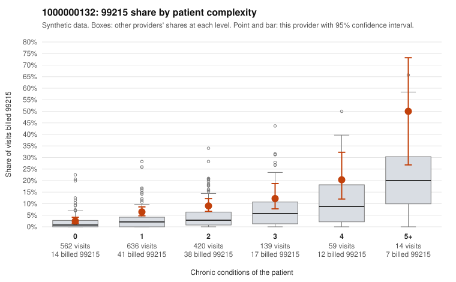

# 1000000132: Elevated 99215 use runs above peer rates at every complexity level above zero conditions, with a large share on low-complexity patients, but only three documented 99215 charts exist, so the pattern is suggestive and unconfirmed.

**Leaning (advisory):** Inconclusive

## Why

1000000132 billed 99215 on 7.0% of 1,830 claims against an expected 2.6% given patient complexity (risk-adjusted score 5.19; plain z-score vs peers 0.38). 43% of this provider's 99215 claims were on patients with 0 or 1 chronic conditions. Records came back for 30 claims. Of 3 documented 99215 claims, 0 (0%) were documented below the billed level, against 3% for the comparison providers. 3 of 20 notes claiming moderate-or-higher data reviewed had no lab or test line on the claim. The billing pattern leans toward upcoding. The provider bills 99215 at roughly 1.5 to 2 times the all-provider share in every complexity band from one condition up, while matching peers only for patients with zero conditions. The sampled low-complexity 99215 claims include routine diagnoses such as upper respiratory infection (C0069982, C0070240, C0071429), follow-up exams (C0070027, C0070347, C0071495) and low back pain (C0070319, C0071001), which do not obviously support high-complexity decision-making. Against this, the high-complexity sample (e.g., C0069995, C0070446) shows genuinely sick patients where 99215 is plausible. The records review cannot settle the question: only 3 documented 99215 claims came back, all supported at high MDM (C0070816, C0071119, C0071749), which is too thin to judge, and the few no-lab notes claiming moderate-plus data review are only weak signals. A reviewer should first request charts specifically for the sampled low-complexity 99215 claims listed above and check whether documented MDM or time actually supports level 5. Examples: C0070329: billed 99214; documented MDM level low, minutes not recorded. C0071908: billed 99213; documented MDM level straightforward, minutes not recorded. C0069982: billed 99215, patient aged 54 with 0 chronic condition(s). C0070010: billed 99215, patient aged 55 with 1 chronic condition(s) (type 2 diabetes).

## Evidence chart

## Cited claims

`C0070329`, `C0071908`, `C0069982`, `C0070010`

## Suggested next steps

- Request records for a larger sample of this provider's 99214 and 99215 claims; what came back is too thin to judge.
- Re-screen the provider once the records arrive.

---
Citations checked: 4/4 valid. Synthetic data. The leaning is advisory; the flag comes from the statistical screen, and no clinical documentation is available beyond the sampled records-review facts shown in the packet.
