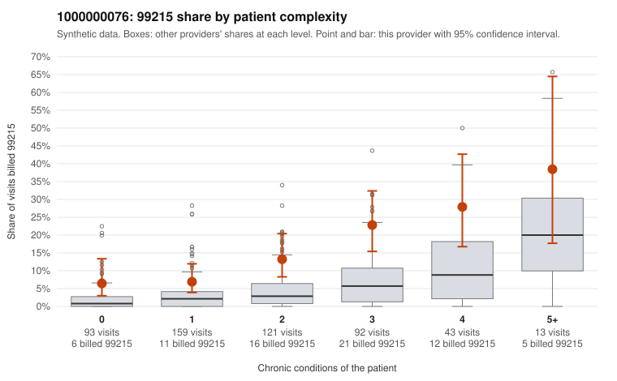

# 1000000076: Provider 1000000076's 99215 rate is elevated in every complexity stratum, but the returned charts largely support the billed levels, so the pattern is inconclusive rather than clearly upcoding or clearly a sicker panel.

**Leaning (advisory):** Inconclusive

## Why

1000000076 billed 99215 on 13.6% of 521 claims against an expected 3.6% given patient complexity (risk-adjusted score 5.45; plain z-score vs peers 1.49). 24% of this provider's 99215 claims were on patients with 0 or 1 chronic conditions. Records came back for 45 claims. Of 21 documented 99215 claims, 1 (5%) were documented below the billed level, against 3% for the comparison providers. Note checks on 45 returned notes (share showing each sign): problems 16%, late 9%, unsigned 0%, data 2%. No audit trail was received. 2 of 30 notes claiming moderate-or-higher data reviewed had no lab or test line on the claim. The returned charts point away from upcoding: documented 99215 claims were unsupported only slightly more often than at comparison providers, and supported examples such as C0036170 are on genuinely complex patients. The by-complexity table cuts the other way. The provider's 99215 share runs roughly two to three times the all-provider share even among patients with 0 or 1 chronic conditions, which is exactly where panel acuity cannot explain it. Sampled low-complexity 99215s such as C0036016 (Z09 follow-up only), C0036411 (J06.9 upper respiratory infection) and C0036554 (R10.9 abdominal pain) are the kind of visits that would be unusual at the highest level. Without an audit trail, the documentation itself cannot be fully trusted, given the problems flag, late notes and roughly one in six notes with a repeated time entry; the data-reviewed mismatch affects only 2 notes and is weak. A reviewer should first check whether any documented 99215s fall on 0–1 condition patients and pull charts for the sampled low-complexity 99215 claims, then request the EHR audit trail to test whether supporting notes were templated or cloned. Examples: C0036557: billed 99215; documented MDM level moderate, 33 minutes. C0036016: billed 99215, patient aged 56 with 0 chronic condition(s). C0036116: billed 99215, patient aged 32 with 1 chronic condition(s) (type 2 diabetes).

## Evidence chart

## Cited claims

`C0036557`, `C0036016`, `C0036116`

## Suggested next steps

- 45 charts came back but do not settle it: request a targeted sample of 99215 charts, starting with C0036557, C0036016, C0036116.
- Re-check after the targeted charts arrive; do not call upcoding or a sicker panel on this evidence alone.

---
Citations checked: 3/3 valid. Synthetic data. The leaning is advisory; the flag comes from the statistical screen, and no clinical documentation is available beyond the sampled records-review facts shown in the packet.
