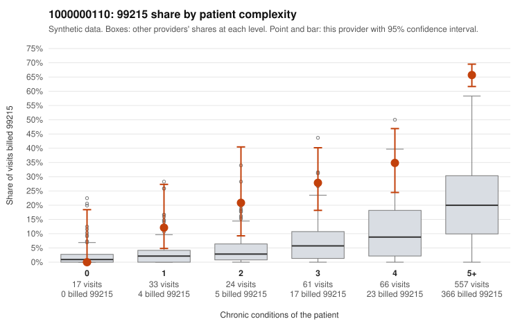

# 1000000110: Provider 1000000110 bills 99215 far above the risk-adjusted expectation on a heavily multi-morbid panel, but the small sample of returned charts mostly supports the billed levels, so the pattern is unresolved.

**Leaning (advisory):** Inconclusive

## Why

1000000110 billed 99215 on 54.7% of 758 claims against an expected 14.3% given patient complexity (risk-adjusted score 14.10; plain z-score vs peers 8.40). 1% of this provider's 99215 claims were on patients with 0 or 1 chronic conditions. Records came back for 30 claims. Of 19 documented 99215 claims, 1 (5%) were documented below the billed level, against 3% for the comparison providers. Note checks on 30 returned notes (share showing each sign): problems 3%, late 10%, unsigned 0%, data 10%. No audit trail was received. 5 of 22 notes claiming moderate-or-higher data reviewed had no lab or test line on the claim. The panel is genuinely complex: most visits are on patients with 5+ conditions, and almost no 99215s fall on 0–1 condition patients (sampled exceptions include C0057861 and C0058186). However, the expected share already adjusts for complexity, and within every complexity stratum this provider's 99215 share runs roughly two to four times the all-provider share, so sicker patients alone do not obviously explain the excess. Against that, the documented 99215s are unsupported at close to the peer rate, and supported examples such as C0058383 and C0058412 show high MDM with plausible minutes. Those charts cover only about 4% of claims, though, and there are softer signs the notes may be inflated or templated: some notes claim moderate-or-higher data review with no lab or test line on the claim, time entries repeat in about 16% of notes, and no audit trail was received. A reviewer should first request a larger stratified chart sample focused on 5+ condition 99215 visits, plus the EHR audit trail. They should check whether the documented MDM and data elements reflect actual work, starting with data-flagged notes like C0057752 and C0058040 and repeated-time entries. Examples: C0058153: billed 99215; documented MDM level moderate, minutes not recorded. C0057861: billed 99215, patient aged 53 with 1 chronic condition(s) (depression). C0058186: billed 99215, patient aged 43 with 1 chronic condition(s) (COPD).

## Evidence chart

## Cited claims

`C0058153`, `C0057861`, `C0058186`

## Suggested next steps

- 30 charts came back but do not settle it: request a targeted sample of 99215 charts, starting with C0058153, C0057861, C0058186.
- Re-check after the targeted charts arrive; do not call upcoding or a sicker panel on this evidence alone.

---
Citations checked: 3/3 valid. Synthetic data. The leaning is advisory; the flag comes from the statistical screen, and no clinical documentation is available beyond the sampled records-review facts shown in the packet.
