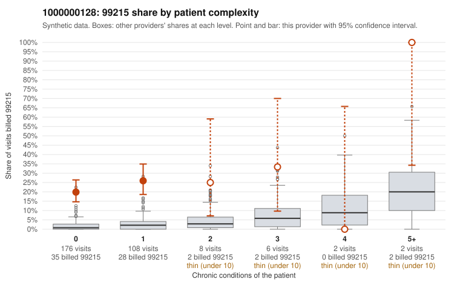

# 1000000128: 1000000128: 0 of 13 documented 99215 claims (0%) are documented below the billed level

**Leaning (advisory):** Pattern consistent with upcoding

## Why

1000000128 billed 99215 on 22.8% of 302 claims against an expected 1.9% given patient complexity (risk-adjusted score 11.87; plain z-score vs peers 3.04). 91% of this provider's 99215 claims were on patients with 0 or 1 chronic conditions. Records came back for 30 claims. Of 13 documented 99215 claims, 0 (0%) were documented below the billed level, against 3% for the comparison providers. Note checks on 30 returned notes (share showing each sign): problems 57%, late 17%, unsigned 0%, data 7%, bulk created 13%, paste heavy 20%. 5 of 22 notes claiming moderate-or-higher data reviewed had no lab or test line on the claim. This pattern is consistent with upcoding. It is a reason to review the records, not a finding. Examples: C0068352: billed 99214; documented MDM level low, 21 minutes. C0068179: billed 99215, patient aged 40 with 1 chronic condition(s) (hyperlipidemia). C0068185: billed 99215, patient aged 63 with 1 chronic condition(s) (hypertension). C0068200: billed 99215, patient aged 55 with 0 chronic condition(s).

## Evidence chart

## Cited claims

`C0068352`, `C0068179`, `C0068185`, `C0068200`

## Suggested next steps

- Request the full charts for C0068352, C0068179, C0068185 and have a certified coder re-score each against the current E/M rules (medical decision making or total time).
- If the re-scoring confirms the pattern, review the random sample in the recovery packet's sampling plan before any overpayment estimate; do not extrapolate from a targeted sample.
- Look at the notes themselves: 57% address fewer problems than their level implies and 17% were signed late; request the audit trail for C0068352, C0068179, C0068185.

---
Citations checked: 4/4 valid. Synthetic data. The leaning is advisory; the flag comes from the statistical screen, and no clinical documentation is available beyond the sampled records-review facts shown in the packet.
