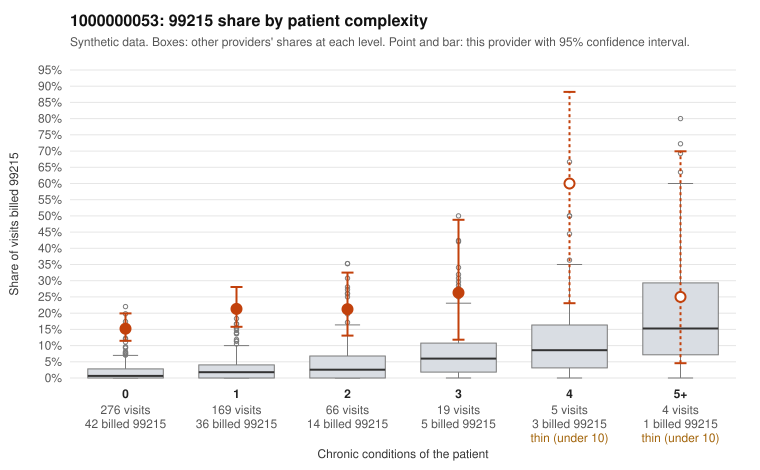

# 1000000053: 1000000053: 7 of 7 documented 99215 claims (100%) are documented below the billed level

**Leaning (advisory):** Pattern consistent with upcoding

## Why

1000000053 billed 99215 on 18.7% of 539 claims against an expected 1.9% given patient complexity (risk-adjusted score 11.15; plain z-score vs peers 2.15). 77% of this provider's 99215 claims were on patients with 0 or 1 chronic conditions. Records came back for 30 claims. Of 7 documented 99215 claims, 7 (100%) were documented below the billed level, against 5% for the comparison providers. 1 of 19 notes claiming moderate-or-higher data reviewed had no lab or test line on the claim. This pattern is consistent with upcoding. It is a reason to review the records, not a finding. Examples: C0027887: billed 99215; documented MDM level moderate, 32 minutes. C0028082: billed 99215, patient aged 76 with 1 chronic condition(s) (hypertension); documented MDM level moderate, 30 minutes. C0028122: billed 99215; documented MDM level moderate, 39 minutes. C0027890: billed 99215, patient aged 46 with 1 chronic condition(s) (heart failure). C0027895: billed 99215, patient aged 33 with 0 chronic condition(s). C0027912: billed 99215, patient aged 44 with 0 chronic condition(s).

## Evidence chart

## Cited claims

`C0027887`, `C0028082`, `C0028122`, `C0027890`, `C0027895`, `C0027912`

## Suggested next steps

- Request the full records for the cited claims and have a certified coder re-score each against current E/M documentation rules (medical decision making or total time).
- If the re-scoring confirms the pattern, use the sampling plan in the recovery packet to review a statistical sample of this provider's 99215 claims.
- Check whether notes for the cited claims look copied forward, and whether documented minutes repeat from visit to visit.

---
Citations checked: 6/6 valid. Synthetic data. The leaning is advisory; the flag comes from the statistical screen, and no clinical documentation is available beyond the sampled records-review facts shown in the packet.
