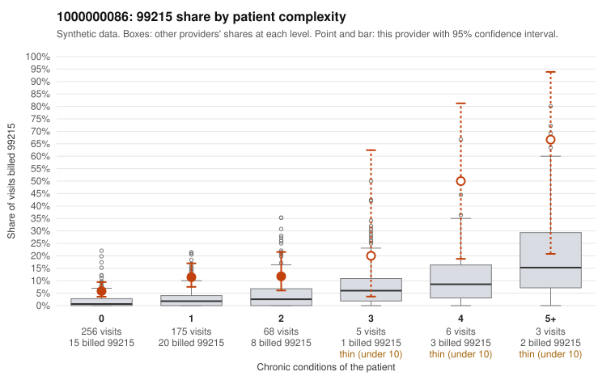

# 1000000086: Provider 1000000086 bills 99215 well above its risk-adjusted expectation, mostly on patients with few or no chronic conditions, but there are too few charts to confirm or refute it.

**Leaning (advisory):** Pattern consistent with upcoding

## Why

1000000086 billed 99215 on 9.6% of 513 claims against an expected 1.8% given patient complexity (risk-adjusted score 5.05; plain z-score vs peers 0.70). 71% of this provider's 99215 claims were on patients with 0 or 1 chronic conditions. Records came back for 30 claims. Of 2 documented 99215 claims, 0 (0%) were documented below the billed level, against 5% for the comparison providers. 3 of 22 notes claiming moderate-or-higher data reviewed had no lab or test line on the claim. The claims pattern is consistent with upcoding. The 99215 share is above the all-provider rate in every complexity stratum, and most 99215s fall on 0–1 condition patients. Sampled examples carry simple diagnoses such as rash (R21), upper respiratory infection (J06.9), low back pain (M54.50) and follow-up (Z09), for example C0045970, C0046056 and C0046072. The high-complexity 99215 examples (e.g., C0046050, C0046332) look appropriate, and the modest peer z-score suggests some of the elevation may reflect peer norms, so the risk-adjusted gap is the stronger signal. Documentation is too thin to judge: only two 99215 charts came back, and both supported the billed level. One of them, C0046396, is a 0-condition rash visit documented as high MDM with no minutes recorded, which warrants a check for cloned or inflated notes. The 3 moderate-plus data-reviewed notes without a lab line are only weak support for that concern. A reviewer should first request records for the low-complexity 99215 claims listed here and compare their MDM narratives for templated language. They should also note the heavy 99214 volume as a possible secondary concern. Examples: C0045943: billed 99215, patient aged 18 with 1 chronic condition(s) (COPD). C0045970: billed 99215, patient aged 40 with 0 chronic condition(s). C0045974: billed 99215, patient aged 40 with 0 chronic condition(s).

## Evidence chart

## Cited claims

`C0045943`, `C0045970`, `C0045974`

## Suggested next steps

- Request the full records for the cited claims and have a certified coder re-score each against current E/M documentation rules (medical decision making or total time).
- If the re-scoring confirms the pattern, use the sampling plan in the recovery packet to review a statistical sample of this provider's 99215 claims.
- Check whether notes for the cited claims look copied forward, and whether documented minutes repeat from visit to visit.

---
Citations checked: 3/3 valid. Synthetic data. The leaning is advisory; the flag comes from the statistical screen, and no clinical documentation is available beyond the sampled records-review facts shown in the packet.
