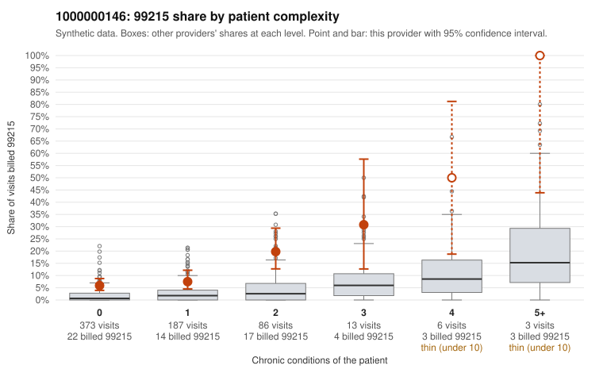

# 1000000146: Provider 1000000146's 99215 billing runs well above what its patient complexity predicts and is concentrated on patients with few or no chronic conditions, a pattern consistent with upcoding, though the chart review is too thin to confirm it.

**Leaning (advisory):** Pattern consistent with upcoding

## Why

1000000146 billed 99215 on 9.4% of 668 claims against an expected 1.8% given patient complexity (risk-adjusted score 5.82; plain z-score vs peers 0.68). 57% of this provider's 99215 claims were on patients with 0 or 1 chronic conditions. Records came back for 30 claims. Of 3 documented 99215 claims, 0 (0%) were documented below the billed level, against 5% for the comparison providers. 1 of 18 notes claiming moderate-or-higher data reviewed had no lab or test line on the claim. The risk-adjusted excess is the main signal, and the plain peer z-score is modest, so the concern comes from billing relative to case mix rather than raw volume. The 99215 share runs about three times the all-provider rate in every complexity stratum, and most 99215s fall on 0–1 condition patients. Sampled low-complexity claims such as C0075079 and C0075177 (R21 rash), C0075071 and C0075332 (J06.9 upper respiratory infection) and C0075081 (Z09 follow-up) carry diagnoses that rarely support high-complexity decision-making. The documentation neither confirms nor refutes this: only 3 documented 99215s came back, and all were supported. One of those, C0075150, is a single-condition depression visit with high decision-making complexity (MDM) and 49 minutes recorded, a reminder that some low-complexity 99215s may be legitimate. A reviewer should first request charts for the sampled low-complexity 99215 claims, prioritizing the symptom-only and Z09 encounters, and check whether the notes support high MDM or time. They should also watch for templated or cloned note language, although the one data-reviewed mismatch is too small to weigh. Examples: C0074719: billed 99214; documented MDM level low, minutes not recorded. C0074690: billed 99215, patient aged 38 with 1 chronic condition(s) (type 2 diabetes). C0074749: billed 99215, patient aged 60 with 1 chronic condition(s) (atrial fibrillation). C0074824: billed 99215, patient aged 48 with 1 chronic condition(s) (hypertension).

## Evidence chart

## Cited claims

`C0074719`, `C0074690`, `C0074749`, `C0074824`

## Suggested next steps

- Request the full records for the cited claims and have a certified coder re-score each against current E/M documentation rules (medical decision making or total time).
- If the re-scoring confirms the pattern, use the sampling plan in the recovery packet to review a statistical sample of this provider's 99215 claims.
- Check whether notes for the cited claims look copied forward, and whether documented minutes repeat from visit to visit.

---
Citations checked: 4/4 valid. Synthetic data. The leaning is advisory; the flag comes from the statistical screen, and no clinical documentation is available beyond the sampled records-review facts shown in the packet.
