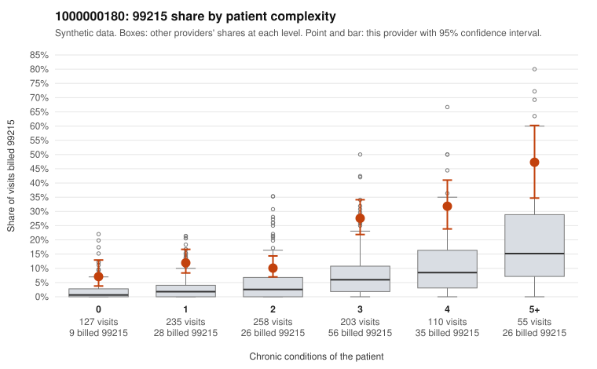

# 1000000180: Elevated 99215 billing exceeds what this panel's complexity predicts in every complexity band, but records came back for too few claims to confirm or rule out upcoding.

**Leaning (advisory):** Inconclusive

## Why

1000000180 billed 99215 on 18.2% of 988 claims against an expected 4.4% given patient complexity (risk-adjusted score 8.35; plain z-score vs peers 2.07). 21% of this provider's 99215 claims were on patients with 0 or 1 chronic conditions. Records came back for 13 claims. Of 3 documented 99215 claims, 2 (67%) were documented below the billed level, against 5% for the comparison providers. 0 of 4 notes claiming moderate-or-higher data reviewed had no lab or test line on the claim. The panel does skew complex, and 99215 share rises with condition count as expected, yet this provider's 99215 share is roughly two to four times the all-provider share within each complexity band, including patients with zero or one condition. That means case mix alone does not appear to explain the excess. Sampled low-complexity 99215 claims such as C0085924, C0085976 and C0085999 (J06.9 upper respiratory infection only) and C0086143 (N39.0 urinary tract infection only) are the kind of visits where a top-level code is hardest to justify. The documentation signal points toward unsupported billing: 2 of 3 documented 99215s fell below the billed level, including C0085753 with low MDM and even the complex-patient claim C0085805. However, three documented 99215s is far too thin a base to lean on, and only one supported 99215 (C0086307) is available for contrast. A reviewer should first request charts for a targeted set of low-complexity 99215 claims, starting with the acute single-diagnosis visits listed above, and check documented MDM and time against the billed level. Examples: C0085753: billed 99215; documented MDM level low, minutes not recorded. C0085805: billed 99215, patient aged 94 with 4 chronic condition(s) (hypothyroidism;type 2 diabetes;depression;hypertension); documented MDM level moderate, 35 minutes. C0085576: billed 99215, patient aged 42 with 1 chronic condition(s) (hypertension). C0085628: billed 99215, patient aged 55 with 0 chronic condition(s).

## Evidence chart

## Cited claims

`C0085753`, `C0085805`, `C0085576`, `C0085628`

## Suggested next steps

- Request records for a larger sample of this provider's 99214 and 99215 claims; what came back is too thin to judge.
- Re-screen the provider once the records arrive.

---
Citations checked: 4/4 valid. Synthetic data. The leaning is advisory; the flag comes from the statistical screen, and no clinical documentation is available beyond the sampled records-review facts shown in the packet.
