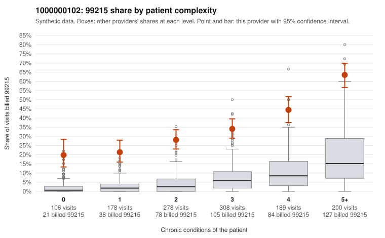

# Payment Integrity dossier: 1000000102

> Draft for human review. Statistical and records-sample evidence only; not a finding. Compliance or legal review is needed before any provider contact, notice or recoupment.

## Provider overview

| | |
|---|---|
| Specialty / state | Family Practice, GA (synthetic) |
| Claims / patients | 1,259 / 649 |
| Billed mix (99211 to 99215) | 5 / 5 / 188 / 608 / 453 |
| 99215 share | 36.0% |
| Expected 99215 share given patient complexity | 6.3% |
| Screen scores | z vs peers 4.87; risk-adjusted 17.11; flagged by suspicion>=5 |

## Case summary (advisory)

**Provider 1000000102's 99215 rate is elevated within every patient-complexity band, including patients with no chronic conditions, and a small documentation sample shows unsupported 99215s well above peers, a pattern consistent with upcoding.**

Leaning: pattern consistent with upcoding. Citations checked: 6/6 valid.

1000000102 billed 99215 on 36.0% of 1,259 claims against an expected 6.3% given patient complexity (risk-adjusted score 17.11; plain z-score vs peers 4.87). 13% of this provider's 99215 claims were on patients with 0 or 1 chronic conditions. Records came back for 30 claims. Of 11 documented 99215 claims, 4 (36%) were documented below the billed level, against 5% for the comparison providers. 1 of 22 notes claiming moderate-or-higher data reviewed had no lab or test line on the claim. A sicker panel does not explain the stratified table. The 99215 share runs far above the all-provider share in every band, and the gap is widest for patients with 0 or 1 conditions, where sampled claims such as C0053089 (J06.9, upper respiratory infection), C0053625 (R21, rash) and C0053588 (R10.9, abdominal pain) carry routine diagnoses. Documentation points the same way. The four unsupported 99215s (C0053146, C0053797, C0054171, C0054218) each show moderate MDM, which fits a one-level bump. The supported cases, such as C0053936 with high MDM on a four-condition patient, show some 99215s are legitimate. The main ambiguity is that only 11 documented 99215 claims exist, so the documentation result sits between the rule's cutoffs and cannot settle the question alone. There is little sign of cloned notes, since only 1 note claiming moderate-or-higher data reviewed lacked a lab or test line. A reviewer should first obtain charts for the sampled low-complexity 99215 claims to test whether high MDM or 40+ minutes is documented, then widen the records request to firm up the 99215 unsupported rate. Examples: C0053146: billed 99215; documented MDM level moderate, 33 minutes. C0053797: billed 99215; documented MDM level moderate, 39 minutes. C0054171: billed 99215; documented MDM level moderate, 25 minutes. C0053089: billed 99215, patient aged 68 with 0 chronic condition(s). C0053111: billed 99215, patient aged 49 with 1 chronic condition(s) (chronic kidney disease). C0053112: billed 99215, patient aged 68 with 0 chronic condition(s).

## Evidence chart

## Records-review sample so far

Documentation is on file for 30 claims (2% of this provider's claims).

| Billed | Documented | Documentation below billed level | Rate | All-provider rate |
|---|---|---|---|---|
| 99213 | 4 | 0 | 0.0% | 1.6% |
| 99214 | 15 | 2 | 13.3% | 3.0% |
| 99215 | 11 | 4 | 36.4% | 4.8% |

## Recommended next steps for Payment Integrity

1. Request records for the sampled claims in `record_request_list.csv` (59 claims across 99215).
2. Review the records against E/M documentation rules and record the supported level for each claim.
3. Run the overpayment estimator on the reviewed sample (`sampling_plan.md` explains how).
4. Notice, appeal rights, recoupment, education or corrective action, and any referral are decisions for the PI team, compliance and counsel. Nothing here drafts those.

Suggested follow-ups from the case summary:

- Request the full records for the cited claims and have a certified coder re-score each against current E/M documentation rules (medical decision making or total time).
- If the re-scoring confirms the pattern, use the sampling plan in the recovery packet to review a statistical sample of this provider's 99215 claims.
- Check whether notes for the cited claims look copied forward, and whether documented minutes repeat from visit to visit.

## Limits

- Synthetic data; no real claims or providers.
- The leaning is advisory. The flag comes from the statistical screen; the summary explains it.
- The records-review sample is partial and was simulated for this project.
- Allowed amounts are GA Family Practice averages from a public CMS file, not this provider's actual payments.
