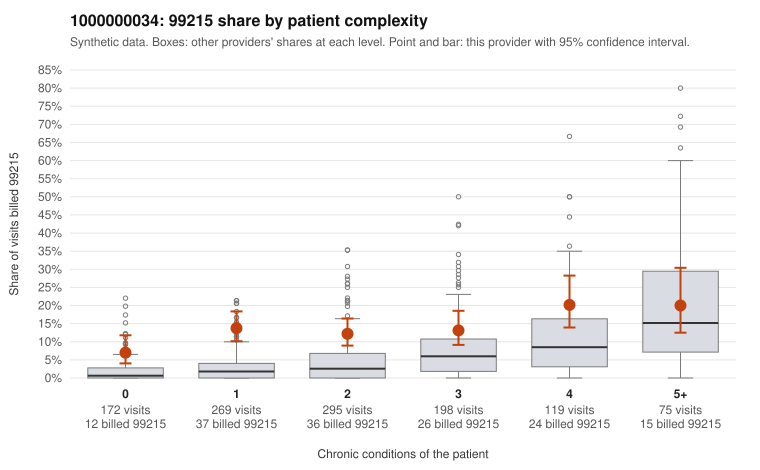

# 1000000034: Provider 1000000034 bills 99215 at about three times the complexity-adjusted expectation, mostly on low-complexity patients, but the small set of returned charts largely supports the billed level, so the picture is mixed.

**Leaning (advisory):** Inconclusive

## Why

1000000034 billed 99215 on 13.3% of 1,128 claims against an expected 4.4% given patient complexity (risk-adjusted score 5.74; plain z-score vs peers 1.29). 33% of this provider's 99215 claims were on patients with 0 or 1 chronic conditions. Records came back for 44 claims. Of 16 documented 99215 claims, 1 (6%) were documented below the billed level, against 5% for the comparison providers. Note checks on 44 returned notes (share showing each sign): problems 16%, late 14%, unsigned 0%, data 16%. No audit trail was received. 9 of 37 notes claiming moderate-or-higher data reviewed had no lab or test line on the claim. The billing pattern raises concern: the 99215 excess is not concentrated among the sickest patients. The provider's 99215 share runs several times the all-provider share for patients with 0 or 1 conditions, while for patients with 5 or more conditions it is actually below peers. The sampled low-complexity 99215 claims include routine-looking diagnoses such as upper respiratory infection (C0015461), rash (C0015230) and low back pain (C0014979). Against this, the documented 99215 claims mostly support the billed level, with an unsupported rate close to the comparison providers. That would normally point toward a legitimately complex panel, but records cover only a small fraction of claims and no audit trail was received. The notes also show signs of possible cloning or inflation: duplicate and repeated-time flags, plus notes claiming moderate-or-higher data review on claims with no lab or test line. This is weak evidence that documentation may have been written to match the billed level rather than what happened. A reviewer should first request charts specifically for the sampled low-complexity 99215 claims, starting with C0014989, which also carries a problems-list flag, and obtain the EHR audit trail to check whether those notes were templated or pasted. Examples: C0015174: billed 99215; documented MDM level moderate, minutes not recorded. C0014931: billed 99215, patient aged 68 with 1 chronic condition(s) (atrial fibrillation). C0014971: billed 99215, patient aged 72 with 1 chronic condition(s) (hypertension).

## Evidence chart

## Cited claims

`C0015174`, `C0014931`, `C0014971`

## Suggested next steps

- 44 charts came back but do not settle it: request a targeted sample of 99215 charts, starting with C0015174, C0014931, C0014971.
- Re-check after the targeted charts arrive; do not call upcoding or a sicker panel on this evidence alone.

---
Citations checked: 3/3 valid. Synthetic data. The leaning is advisory; the flag comes from the statistical screen, and no clinical documentation is available beyond the sampled records-review facts shown in the packet.
