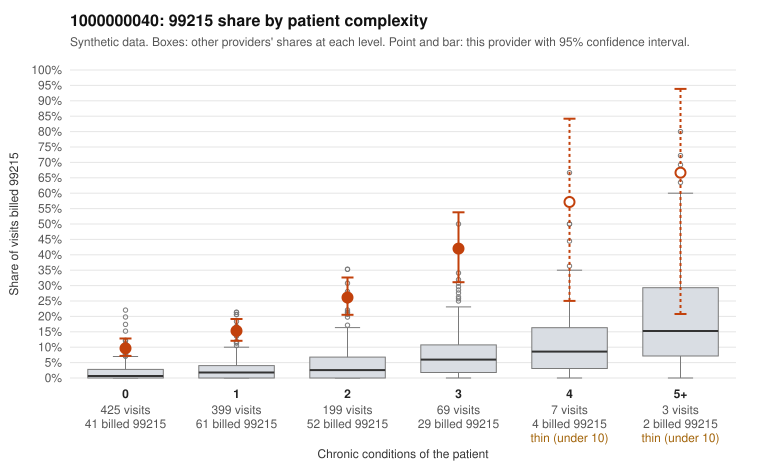

# 1000000040: Provider 1000000040 bills 99215 far above expectation, including on many low-complexity patients, but the small documented sample largely supports the billed level, so the pattern is unresolved.

**Leaning (advisory):** Inconclusive

## Why

1000000040 billed 99215 on 17.2% of 1,102 claims against an expected 2.1% given patient complexity (risk-adjusted score 13.62; plain z-score vs peers 1.90). 54% of this provider's 99215 claims were on patients with 0 or 1 chronic conditions. Records came back for 45 claims. Of 20 documented 99215 claims, 1 (5%) were documented below the billed level, against 5% for the comparison providers. Note checks on 45 returned notes (share showing each sign): problems 42%, late 2%, unsigned 0%, data 4%, bulk created 0%, paste heavy 0%. 4 of 35 notes claiming moderate-or-higher data reviewed had no lab or test line on the claim. The billing side looks concerning. The 99215 share runs several times the all-provider rate in every complexity stratum, including patients with no chronic conditions, and the sampled low-complexity 99215 claims carry routine diagnoses such as UTI, URI and rash (e.g., C0017515, C0017692, C0017998), which is not what a sicker panel explains. Against that, the documented 99215 claims mismatch at about the peer rate, and the supported examples (C0017531, C0017966, C0018595) record high MDM, so the records reviewed so far do not show upcoding. That documentation covers only about 4% of claims, though, and the 42% problems-flag rate on returned notes plus the few moderate-plus data claims without a lab line are weak signs that notes may be inflated to match billing, not proof. A reviewer should first request charts targeted at the low-complexity 99215 claims and check whether their documented MDM holds up, then look at the problems-flagged notes (C0017497, C0017521, C0017542) for templated or overstated problem lists. Examples: C0017765: billed 99215, patient aged 18 with 0 chronic condition(s); documented MDM level moderate, minutes not recorded. C0017445: billed 99215, patient aged 44 with 1 chronic condition(s) (hypertension). C0017515: billed 99215, patient aged 40 with 0 chronic condition(s).

## Evidence chart

## Cited claims

`C0017765`, `C0017445`, `C0017515`

## Suggested next steps

- 45 charts came back but do not settle it: request a targeted sample of 99215 charts, starting with C0017765, C0017445, C0017515.
- Re-check after the targeted charts arrive; do not call upcoding or a sicker panel on this evidence alone.

---
Citations checked: 3/3 valid. Synthetic data. The leaning is advisory; the flag comes from the statistical screen, and no clinical documentation is available beyond the sampled records-review facts shown in the packet.
