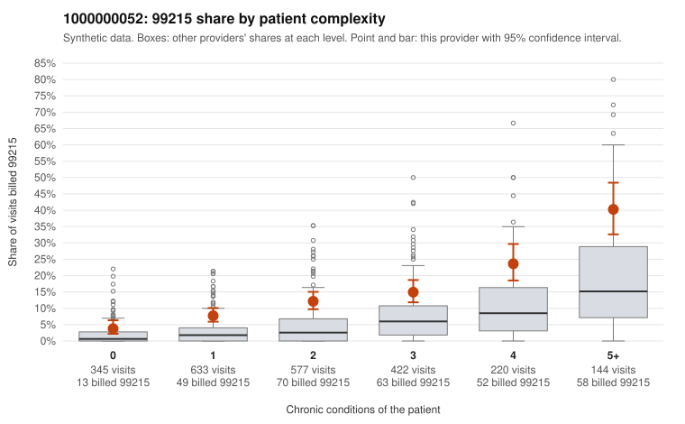

# 1000000052: Provider 1000000052 bills 99215 at roughly twice the all-provider rate in every complexity band, including visits with no chronic conditions, but the few returned charts support the billed level, so the pattern is not resolved.

**Leaning (advisory):** Inconclusive

## Why

1000000052 billed 99215 on 13.0% of 2,341 claims against an expected 4.2% given patient complexity (risk-adjusted score 8.32; plain z-score vs peers 1.25). 20% of this provider's 99215 claims were on patients with 0 or 1 chronic conditions. Records came back for 30 claims. Of 6 documented 99215 claims, 0 (0%) were documented below the billed level, against 5% for the comparison providers. Note checks on 30 returned notes (share showing each sign): problems 20%, late 0%, unsigned 0%, data 3%. No audit trail was received. 3 of 21 notes claiming moderate-or-higher data reviewed had no lab or test line on the claim. The excess is not explained by panel acuity: the by-complexity table shows this provider's 99215 share running about double the all-provider share at every condition count. The sampled low-complexity 99215s include several single-diagnosis upper respiratory infection visits (J06.9, e.g., C0025950, C0026179, C0026388) that would rarely need high-complexity decision-making. That fits a pattern consistent with upcoding. On the other side, all 6 documented 99215 claims were supported, with high MDM and 42–48 minutes where time was recorded (e.g., C0025533). But 6 charts, from only about 1% of claims returned, are too thin to clear the pattern, especially since all supported examples are high-complexity patients. Softer signals point the same cautious direction without proving anything: 99214 claims show an above-peer below-billed rate (2 of 22), 20% of notes carry problem-list flags, and there are repeated time entries. The 3 data-reviewed notes with no lab line on the claim are weak evidence of templated documentation, and no audit trail was received. A reviewer should first request charts for the low-complexity 99215 claims, starting with the J06.9 and Z09 visits. They should also obtain the EHR audit trail to check whether notes were cloned or bulk-created. Examples: C0025608: billed 99214; documented MDM level low, minutes not recorded. C0025694: billed 99214; documented MDM level low, minutes not recorded. C0025489: billed 99215, patient aged 37 with 1 chronic condition(s) (depression). C0025950: billed 99215, patient aged 33 with 0 chronic condition(s).

## Evidence chart

## Cited claims

`C0025608`, `C0025694`, `C0025489`, `C0025950`

## Suggested next steps

- 30 charts came back but do not settle it: request a targeted sample of 99215 charts, starting with C0025608, C0025694, C0025489.
- Re-check after the targeted charts arrive; do not call upcoding or a sicker panel on this evidence alone.

---
Citations checked: 4/4 valid. Synthetic data. The leaning is advisory; the flag comes from the statistical screen, and no clinical documentation is available beyond the sampled records-review facts shown in the packet.
