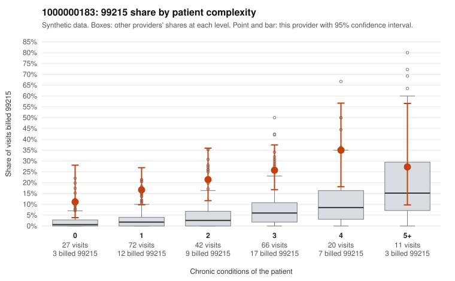

# 1000000183: Provider 1000000183 bills 99215 far above risk-adjusted expectation in every complexity band, and the records reviewed support the billed levels, but note-quality signals raise the possibility that the documentation was inflated to match.

**Leaning (advisory):** Inconclusive

## Why

1000000183 billed 99215 on 21.4% of 238 claims against an expected 4.2% given patient complexity (risk-adjusted score 5.17; plain z-score vs peers 2.57). 29% of this provider's 99215 claims were on patients with 0 or 1 chronic conditions. Records came back for 45 claims. Of 20 documented 99215 claims, 0 (0%) were documented below the billed level, against 5% for the comparison providers. Note checks on 45 returned notes (share showing each sign): problems 24%, late 20%, unsigned 0%, data 31%. No audit trail was received. 16 of 36 notes claiming moderate-or-higher data reviewed had no lab or test line on the claim. On its face, the documentation favors a legitimately complex panel: none of the 20 documented 99215 claims fell below the billed level, and sampled supported claims such as C0087425 show high MDM. Against that, the excess 99215 billing appears in every complexity band, including patients with no chronic conditions, and sampled low-complexity 99215s look routine (rash on C0087332 and C0087429, urinary infection on C0087342), which a sicker panel would not explain. The note signals weaken the support: nearly half of the notes claiming moderate-or-higher data reviewed had no lab or test line on the claim, about 29% of notes were flagged as duplicates, most of the sampled supported 99215s recorded no minutes, and no audit trail was received, so cloned or templated notes cannot be ruled out. A reviewer should first pull the full notes for low-complexity 99215s, starting with C0087311, which is flagged for problems, late entry and unsupported data. Compare them against other notes for templated text, check whether the reviewed data matches orders in the record, and request the EHR audit trail before drawing conclusions. Examples: C0087327: billed 99213; documented MDM level straightforward, 19 minutes. C0087285: billed 99215, patient aged 54 with 1 chronic condition(s) (asthma). C0087295: billed 99215, patient aged 79 with 1 chronic condition(s) (hypothyroidism).

## Evidence chart

## Cited claims

`C0087327`, `C0087285`, `C0087295`

## Suggested next steps

- 45 charts came back but do not settle it: request a targeted sample of 99215 charts, starting with C0087327, C0087285, C0087295.
- Re-check after the targeted charts arrive; do not call upcoding or a sicker panel on this evidence alone.

---
Citations checked: 3/3 valid. Synthetic data. The leaning is advisory; the flag comes from the statistical screen, and no clinical documentation is available beyond the sampled records-review facts shown in the packet.
