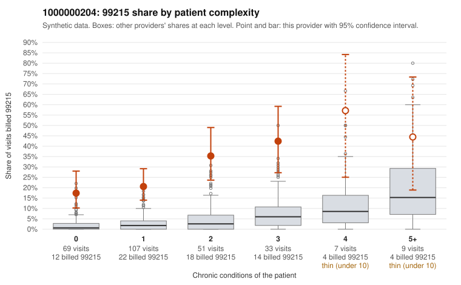

# 1000000204: Provider 1000000204 bills 99215 well above expectation in every complexity tier, including patients with no chronic conditions, but the few returned charts all support the billed level, and the notes show signs of possible templating.

**Leaning (advisory):** Inconclusive

## Why

1000000204 billed 99215 on 26.8% of 276 claims against an expected 3.0% given patient complexity (risk-adjusted score 9.14; plain z-score vs peers 3.42). 46% of this provider's 99215 claims were on patients with 0 or 1 chronic conditions. Records came back for 29 claims. Of 9 documented 99215 claims, 0 (0%) were documented below the billed level, against 5% for the comparison providers. Note checks on 29 returned notes (share showing each sign): problems 38%, late 10%, unsigned 0%, data 14%. No audit trail was received. 6 of 19 notes claiming moderate-or-higher data reviewed had no lab or test line on the claim. The claims pattern does not look like a sicker panel. The 99215 share is elevated against all-provider rates in every condition tier, most sharply among 0- and 1-condition patients, and the sampled low-complexity 99215s are routine presentations such as rash (C0096620, C0096691), follow-up (C0096616, C0096701), URI (C0096866) and UTI (C0096837, C0096875). On the other side, none of the 9 documented 99215 claims was below the billed level, which is the main evidence against upcoding. That evidence is weak for three reasons: it rests on a small share of claims, it includes a low-complexity visit documented as high MDM (C0096676, obesity with abdominal pain), and the note checks raise doubt about the notes themselves (frequent problem-list and duplicate signals, repeated times, no audit trail, and data-reviewed claims unsupported by lab or test lines, e.g. C0096650, C0096677, C0096799). A reviewer should first pull charts for the sampled 0-condition 99215 claims. They should also request the EHR audit trail to check for cloned or bulk-created notes, since well-matched documentation on these visits could reflect templating rather than real complexity. Examples: C0096603: billed 99215, patient aged 57 with 1 chronic condition(s) (COPD). C0096616: billed 99215, patient aged 52 with 0 chronic condition(s).

## Evidence chart

## Cited claims

`C0096603`, `C0096616`

## Suggested next steps

- 29 charts came back but do not settle it: request a targeted sample of 99215 charts, starting with C0096603, C0096616.
- Re-check after the targeted charts arrive; do not call upcoding or a sicker panel on this evidence alone.

---
Citations checked: 2/2 valid. Synthetic data. The leaning is advisory; the flag comes from the statistical screen, and no clinical documentation is available beyond the sampled records-review facts shown in the packet.
