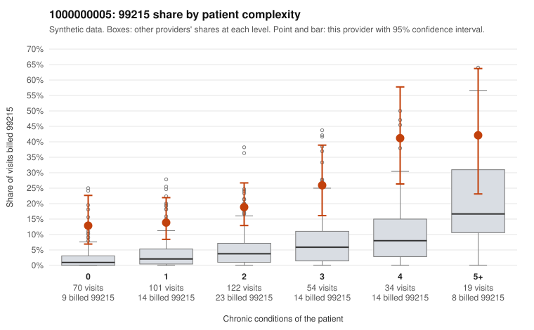

# 1000000005: Provider 1000000005 bills 99215 far above risk-adjusted expectation, including on many low-complexity patients, but the documentation sample is too thin to confirm or refute upcoding.

**Leaning (advisory):** Inconclusive

## Why

1000000005 billed 99215 on 20.5% of 400 claims against an expected 3.7% given patient complexity (risk-adjusted score 5.76; plain z-score vs peers 2.73). 28% of this provider's 99215 claims were on patients with 0 or 1 chronic conditions. Records came back for 30 claims. Of 4 documented 99215 claims, 1 (25%) were documented below the billed level, against 4% for the comparison providers. 2 of 23 notes claiming moderate-or-higher data reviewed had no lab or test line on the claim. The elevated 99215 share holds in every complexity stratum, including patients with 0 or 1 chronic conditions. The sampled low-complexity 99215 claims carry simple diagnoses such as back pain, rash, URI and abdominal pain (e.g., C0001343, C0001444, C0001608, C0001691), a pattern consistent with upcoding rather than a sicker panel, while the high-complexity 99215 claims (e.g., C0001658, C0001674) look clinically plausible. The records review cannot settle the question: only four 99215 claims were documented, one unsupported (C0001613, moderate MDM) and three supported at high MDM (C0001356, C0001382, C0001639). That is too few to judge, and the code's rule check found the pooled result is not lopsided. The two notes claiming moderate-or-higher data reviewed with no lab or test line are weak signals of possible templated documentation, not proof. A reviewer should first request charts for the low-complexity 99215 claims listed in the packet to see whether the notes support high MDM or sufficient time. Minutes were not recorded on any documented example, so time-based support cannot be assessed. Examples: C0001613: billed 99215; documented MDM level moderate, minutes not recorded. C0001343: billed 99215, patient aged 32 with 0 chronic condition(s). C0001393: billed 99215, patient aged 34 with 0 chronic condition(s).

## Evidence chart

## Cited claims

`C0001613`, `C0001343`, `C0001393`

## Suggested next steps

- Request records for a larger sample of this provider's 99214 and 99215 claims; what came back is too thin to judge.
- Re-screen the provider once the records arrive.

---
Citations checked: 3/3 valid. Synthetic data. The leaning is advisory; the flag comes from the statistical screen, and no clinical documentation is available beyond the sampled records-review facts shown in the packet.
