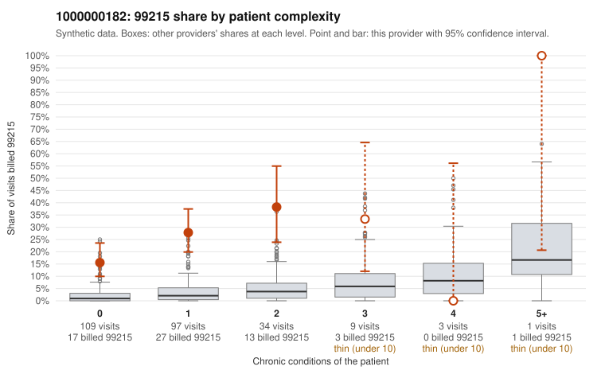

# 1000000182: Provider 1000000182 bills 99215 mostly on patients with few or no chronic conditions, but the five documented 99215 claims all support the billed level, so the records are too thin to confirm or rule out upcoding.

**Leaning (advisory):** Inconclusive

## Why

1000000182 billed 99215 on 24.1% of 253 claims against an expected 2.0% given patient complexity (risk-adjusted score 8.18; plain z-score vs peers 3.38). 72% of this provider's 99215 claims were on patients with 0 or 1 chronic conditions. Records came back for 30 claims. Of 5 documented 99215 claims, 0 (0%) were documented below the billed level, against 4% for the comparison providers. 3 of 23 notes claiming moderate-or-higher data reviewed had no lab or test line on the claim. The claims pattern is the main concern. The 99215 share is above the all-provider rate in every complexity band where this provider has meaningful volume, including patients with no chronic conditions, and most 99215s fall on low-complexity patients. Several sampled examples carry routine diagnoses such as uncomplicated UTI (C0093612), upper respiratory infection (C0093613) and low back pain (C0093678), which is the pattern you would expect from upcoding rather than from a sicker panel. The records do not back that up yet: all five documented 99215 claims were supported, which is too few to judge, and some supported notes look surprising for the patient. For example, C0093684 is a low back pain visit documented at high MDM and 50 minutes, and C0093821 is a 20-year-old with heart failure. These could be genuinely complex visits or inflated or templated notes, and the handful of moderate-plus data-reviewed notes with no lab line is only weak evidence either way. A reviewer should first request charts for the sampled low-complexity 99215 claims, starting with the UTI, URI and back pain visits, and check whether the MDM narratives are substantive or cloned across patients. Examples: C0093756: billed 99214; documented MDM level low, minutes not recorded. C0093612: billed 99215, patient aged 44 with 0 chronic condition(s). C0093613: billed 99215, patient aged 62 with 0 chronic condition(s).

## Evidence chart

## Cited claims

`C0093756`, `C0093612`, `C0093613`

## Suggested next steps

- Request records for a larger sample of this provider's 99214 and 99215 claims; what came back is too thin to judge.
- Re-screen the provider once the records arrive.

---
Citations checked: 3/3 valid. Synthetic data. The leaning is advisory; the flag comes from the statistical screen, and no clinical documentation is available beyond the sampled records-review facts shown in the packet.
