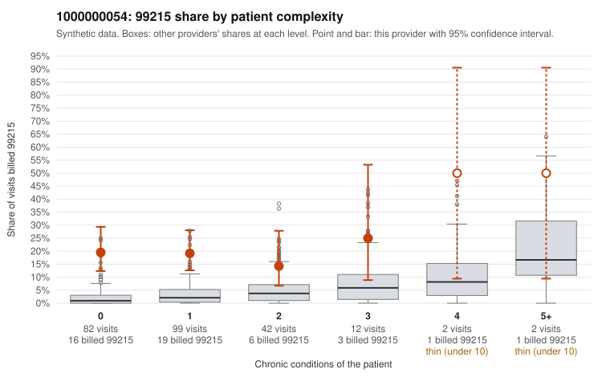

# Payment Integrity dossier: 1000000054

> Draft for human review. Statistical and records-sample evidence only; not a finding. Compliance or legal review is needed before any provider contact, notice or recoupment.

## Provider overview

| | |
|---|---|
| Specialty / state | Family Practice, GA (synthetic) |
| Claims / patients | 239 / 116 |
| Billed mix (99211 to 99215) | 0 / 2 / 59 / 132 / 46 |
| 99215 share | 19.2% |
| Expected 99215 share given patient complexity | 2.1% |
| Screen scores | z vs peers 2.50; risk-adjusted 5.81; flagged by suspicion>=5 |

## Case summary (advisory)

**Provider 1000000054 bills 99215 at a flat high rate regardless of patient complexity, mostly on patients with simple diagnoses, though too few charts came back to confirm upcoding.**

Leaning: pattern consistent with upcoding. Citations checked: 5/5 valid.

1000000054 billed 99215 on 19.2% of 239 claims against an expected 2.1% given patient complexity (risk-adjusted score 5.81; plain z-score vs peers 2.50). 76% of this provider's 99215 claims were on patients with 0 or 1 chronic conditions. Records came back for 30 claims. Of 5 documented 99215 claims, 2 (40%) were documented below the billed level, against 4% for the comparison providers. 2 of 19 notes claiming moderate-or-higher data reviewed had no lab or test line on the claim. The strongest signal is the complexity breakdown: this provider's 99215 share stays near the same level for patients with 0, 1 or 2 conditions, while the all-provider share rises with complexity, and the sampled low-complexity 99215s are mostly routine diagnoses such as UTI (N39.0), rash (R21), upper respiratory infection (J06.9) and follow-up (Z09). That pattern is consistent with upcoding rather than with a sicker panel. The documentation is too thin to settle the question, because only five 99215 charts were reviewed. Two of those five, including C0028397 (single-condition obesity visit), were documented at moderate MDM, which is suggestive but not conclusive at this sample size. The supported examples also deserve a look, since C0028365 is a URI visit on a patient with no chronic conditions that was documented as high MDM, so the reviewer should check that note for cloned or templated content. First, request more charts for the low-complexity 99215 claims (for example C0028361, C0028415, C0028433, C0028521) and compare the documented MDM and time against the diagnoses and the services on each claim. Examples: C0028397: billed 99215, patient aged 45 with 1 chronic condition(s) (obesity); documented MDM level moderate, minutes not recorded. C0028498: billed 99215; documented MDM level moderate, 36 minutes. C0028361: billed 99215, patient aged 37 with 0 chronic condition(s). C0028365: billed 99215, patient aged 52 with 0 chronic condition(s); documented MDM level high, minutes not recorded. C0028382: billed 99215, patient aged 45 with 1 chronic condition(s) (hypertension).

## Evidence chart

## Records-review sample so far

Documentation is on file for 30 claims (13% of this provider's claims).

| Billed | Documented | Documentation below billed level | Rate | All-provider rate |
|---|---|---|---|---|
| 99213 | 6 | 0 | 0.0% | 3.7% |
| 99214 | 18 | 0 | 0.0% | 2.1% |
| 99215 | 5 | 2 | 40.0% | 4.5% |

## Recommended next steps for Payment Integrity

1. Request records for the sampled claims in `record_request_list.csv` (28 claims across 99215).
2. Review the records against E/M documentation rules and record the supported level for each claim.
3. Run the overpayment estimator on the reviewed sample (`sampling_plan.md` explains how).
4. Notice, appeal rights, recoupment, education or corrective action, and any referral are decisions for the PI team, compliance and counsel. Nothing here drafts those.

Suggested follow-ups from the case summary:

- Request the full records for the cited claims and have a certified coder re-score each against current E/M documentation rules (medical decision making or total time).
- If the re-scoring confirms the pattern, use the sampling plan in the recovery packet to review a statistical sample of this provider's 99215 claims.
- Check whether notes for the cited claims look copied forward, and whether documented minutes repeat from visit to visit.

## Limits

- Synthetic data; no real claims or providers.
- The leaning is advisory. The flag comes from the statistical screen; the summary explains it.
- The records-review sample is partial and was simulated for this project.
- Allowed amounts are GA Family Practice averages from a public CMS file, not this provider's actual payments.
