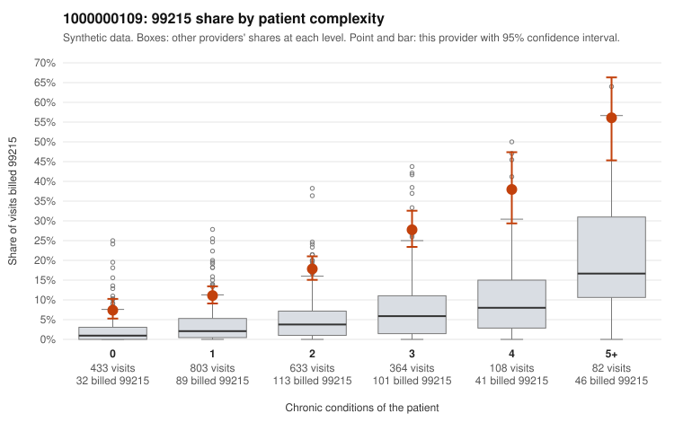

# 1000000109: 99215 billing runs well above expectation in every complexity tier, and the records returned are too few to confirm or rule out upcoding.

**Leaning (advisory):** Inconclusive

## Why

1000000109 billed 99215 on 17.4% of 2,423 claims against an expected 3.2% given patient complexity (risk-adjusted score 12.88; plain z-score vs peers 2.17). 29% of this provider's 99215 claims were on patients with 0 or 1 chronic conditions. Records came back for 30 claims. Of 6 documented 99215 claims, 0 (0%) were documented below the billed level, against 4% for the comparison providers. Note checks on 30 returned notes (share showing each sign): problems 23%, late 0%, unsigned 0%, data 10%. No audit trail was received. 3 of 26 notes claiming moderate-or-higher data reviewed had no lab or test line on the claim. The elevated 99215 share is not explained by a sicker panel. In each chronic-condition tier this provider's share is roughly three times the all-provider share, and nearly three in ten 99215s go to patients with 0–1 conditions, often for single nonspecific diagnoses (e.g., C0054183, C0054373 and C0055028 coded only R10.9 or Z09); together with the heavy 99214 volume, this skew is consistent with upcoding. The records review shows no unsupported 99215s, with supported examples such as C0054968 and C0055220, but only six 99215 charts came back. That is too thin to clear the provider. The note checks also raise mild cloning concerns: about a quarter of notes look duplicated and some repeat visit times, and three of the notes claiming moderate-or-higher data review had no lab or test line on the claim (weak evidence, not proof). A reviewer should first obtain a larger, targeted chart sample of low-complexity 99215 claims, such as those listed above, and request the EHR audit trail to test whether the notes were templated or copied. Examples: C0054733: billed 99214; documented MDM level low, minutes not recorded. C0053985: billed 99215, patient aged 64 with 1 chronic condition(s) (type 2 diabetes). C0054071: billed 99215, patient aged 57 with 1 chronic condition(s) (obesity).

## Evidence chart

## Cited claims

`C0054733`, `C0053985`, `C0054071`

## Suggested next steps

- 30 charts came back but do not settle it: request a targeted sample of 99215 charts, starting with C0054733, C0053985, C0054071.
- Re-check after the targeted charts arrive; do not call upcoding or a sicker panel on this evidence alone.

---
Citations checked: 3/3 valid. Synthetic data. The leaning is advisory; the flag comes from the statistical screen, and no clinical documentation is available beyond the sampled records-review facts shown in the packet.
