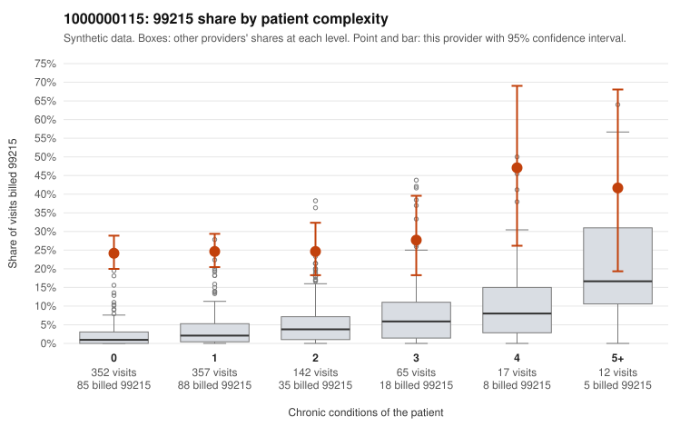

# 1000000115: 1000000115: 0 of 20 documented 99215 claims (0%) are documented below the billed level

**Leaning (advisory):** Pattern consistent with upcoding

## Why

1000000115 billed 99215 on 25.3% of 945 claims against an expected 2.3% given patient complexity (risk-adjusted score 15.48; plain z-score vs peers 3.59). 72% of this provider's 99215 claims were on patients with 0 or 1 chronic conditions. Records came back for 45 claims. Of 20 documented 99215 claims, 0 (0%) were documented below the billed level, against 4% for the comparison providers. Note checks on 45 returned notes (share showing each sign): problems 42%, late 16%, unsigned 0%, data 4%, bulk created 0%, paste heavy 2%. 4 of 37 notes claiming moderate-or-higher data reviewed had no lab or test line on the claim. This pattern is consistent with upcoding. It is a reason to review the records, not a finding. Examples: C0057485: billed 99215, patient aged 41 with 0 chronic condition(s). C0057501: billed 99215, patient aged 49 with 0 chronic condition(s). C0057522: billed 99215, patient aged 57 with 1 chronic condition(s) (hypertension).

## Evidence chart

## Cited claims

`C0057485`, `C0057501`, `C0057522`

## Suggested next steps

- Request the full charts for C0057485, C0057501, C0057522 and have a certified coder re-score each against the current E/M rules (medical decision making or total time).
- If the re-scoring confirms the pattern, review the random sample in the recovery packet's sampling plan before any overpayment estimate; do not extrapolate from a targeted sample.
- Look at the notes themselves: 42% address fewer problems than their level implies and 16% were signed late; request the audit trail for C0057485, C0057501, C0057522.

---
Citations checked: 3/3 valid. Synthetic data. The leaning is advisory; the flag comes from the statistical screen, and no clinical documentation is available beyond the sampled records-review facts shown in the packet.
