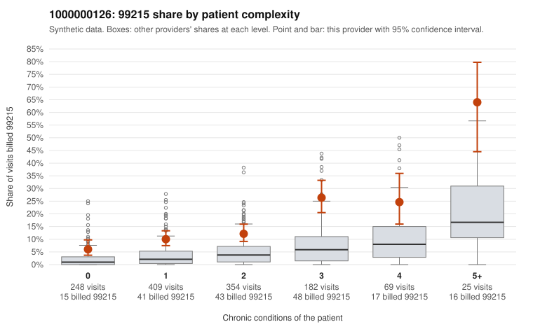

# 1000000126: Provider 1000000126 bills 99215 well above expectation in every complexity band, including many 0–1 condition visits, yet the small set of returned charts all support the billed level.

**Leaning (advisory):** Inconclusive

## Why

1000000126 billed 99215 on 14.0% of 1,287 claims against an expected 3.1% given patient complexity (risk-adjusted score 7.31; plain z-score vs peers 1.56). 31% of this provider's 99215 claims were on patients with 0 or 1 chronic conditions. Records came back for 44 claims. Of 19 documented 99215 claims, 0 (0%) were documented below the billed level, against 4% for the comparison providers. Note checks on 44 returned notes (share showing each sign): problems 23%, late 0%, unsigned 0%, data 4%. No audit trail was received. 2 of 31 notes claiming moderate-or-higher data reviewed had no lab or test line on the claim. The elevation is not confined to complex patients: the 99215 share runs above the all-provider rate in every condition band. The low-complexity sample includes 0-condition visits coded only for rash, abdominal pain or URI (e.g., C0065850, C0065958, C0065759, C0065295), which is the pattern most consistent with upcoding. Against that, none of the 19 documented 99215 claims fell below the billed level, and examples such as C0065376 and C0065557 show high MDM with recorded minutes. However, records cover only a small share of claims, and the problems flag on about a quarter of notes plus repeated time entries raise the possibility of templated or inflated notes; C0065496, a single-condition 99215, appears among the problem-flagged notes. No audit trail was received, so cloning cannot be ruled out. A reviewer should first pull charts for the sampled 0-condition 99215 visits and request the EHR audit trail to check whether the documented complexity reflects the actual encounter. Examples: C0064593: billed 99215, patient aged 57 with 1 chronic condition(s) (hyperlipidemia). C0064701: billed 99215, patient aged 44 with 1 chronic condition(s) (hypertension).

## Evidence chart

## Cited claims

`C0064593`, `C0064701`

## Suggested next steps

- 44 charts came back but do not settle it: request a targeted sample of 99215 charts, starting with C0064593, C0064701.
- Re-check after the targeted charts arrive; do not call upcoding or a sicker panel on this evidence alone.

---
Citations checked: 2/2 valid. Synthetic data. The leaning is advisory; the flag comes from the statistical screen, and no clinical documentation is available beyond the sampled records-review facts shown in the packet.
