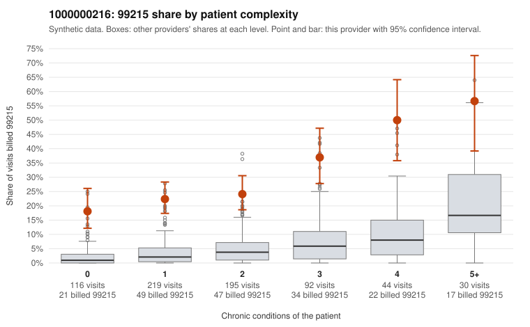

# 1000000216: Provider 1000000216 bills 99215 far above risk-adjusted expectation in every complexity tier, but the small set of returned charts mostly supports the billed level, so the documentation itself needs scrutiny before a conclusion.

**Leaning (advisory):** Inconclusive

## Why

1000000216 billed 99215 on 27.3% of 696 claims against an expected 3.4% given patient complexity (risk-adjusted score 11.27; plain z-score vs peers 3.95). 37% of this provider's 99215 claims were on patients with 0 or 1 chronic conditions. Records came back for 44 claims. Of 20 documented 99215 claims, 2 (10%) were documented below the billed level, against 4% for the comparison providers. Note checks on 44 returned notes (share showing each sign): problems 34%, late 0%, unsigned 0%, data 7%. No audit trail was received. 3 of 38 notes claiming moderate-or-higher data reviewed had no lab or test line on the claim. The claim pattern is not what a sicker panel would explain: 99215 use is elevated in every complexity tier, including patients with no chronic conditions. The sampled low-complexity 99215s are for routine problems such as UTI, upper respiratory infection, rash, back pain and follow-up visits (e.g., C0109339, C0109405, C0109343, C0109767). Against that, the documented 99215s only modestly exceed the comparison unsupported rate, and with 2 of 20 claims this is too small a difference to call meaningful. Records cover only a small share of claims, and the charts that support high MDM may themselves be inflated. C0109343, a rash visit in a 23-year-old with no chronic conditions, is documented as high MDM. Many supported 99215 notes record no minutes. A third of notes carry a problems flag, some show repeated times, and no audit trail was received. A reviewer should first pull the full notes for the low-complexity 99215s with high documented MDM (starting with C0109343 and the problems-flagged examples C0109340 and C0109473). They should check whether the MDM elements reflect a real encounter or templated text, and should request the EHR audit trail and a larger records sample to test whether the documentation holds up. Examples: C0109477: billed 99215; documented MDM level moderate, minutes not recorded. C0109845: billed 99215, patient aged 41 with 0 chronic condition(s); documented MDM level moderate, minutes not recorded. C0109323: billed 99215, patient aged 59 with 1 chronic condition(s) (chronic kidney disease). C0109328: billed 99215, patient aged 43 with 0 chronic condition(s).

## Evidence chart

## Cited claims

`C0109477`, `C0109845`, `C0109323`, `C0109328`

## Suggested next steps

- 44 charts came back but do not settle it: request a targeted sample of 99215 charts, starting with C0109477, C0109845, C0109323.
- Re-check after the targeted charts arrive; do not call upcoding or a sicker panel on this evidence alone.

---
Citations checked: 4/4 valid. Synthetic data. The leaning is advisory; the flag comes from the statistical screen, and no clinical documentation is available beyond the sampled records-review facts shown in the packet.
