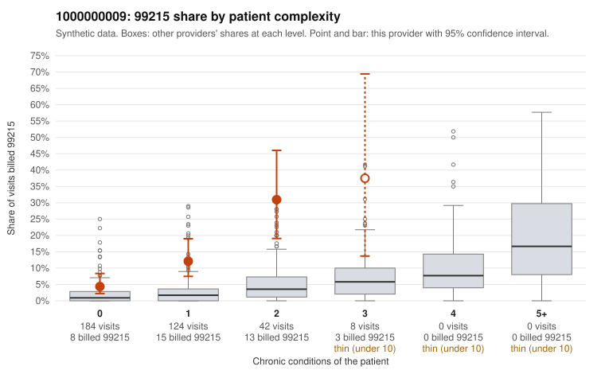

# 1000000009: Provider 1000000009 bills 99215 far above the complexity-adjusted expectation and mostly on low-complexity patients, but the few charts returned support the billed levels, so documentation is too thin to resolve the question.

**Leaning (advisory):** Inconclusive

## Why

1000000009 billed 99215 on 10.9% of 358 claims against an expected 1.7% given patient complexity (risk-adjusted score 5.13; plain z-score vs peers 0.94). 59% of this provider's 99215 claims were on patients with 0 or 1 chronic conditions. Records came back for 30 claims. Of 4 documented 99215 claims, 0 (0%) were documented below the billed level, against 0% for the comparison providers. 3 of 18 notes claiming moderate-or-higher data reviewed had no lab or test line on the claim. The billing pattern raises concern. The 99215 excess holds across every complexity stratum, most 99215s fall on patients with 0 or 1 chronic conditions, and the sampled low-complexity 99215s include routine diagnoses such as upper respiratory infection (C0006102, C0006122), back pain (C0006290, C0006363) and UTI (C0006269, C0006404). No high-complexity 99215 examples appear in the sample. Against that, all four documented 99215 claims were supported at high MDM, including two low-complexity visits (C0006102, C0006128), and no documented claim at any level fell below the billed level. However, four charts are far too few to judge, and two of those supported notes have no recorded minutes. The small share of moderate-or-higher data-reviewed notes with no lab or test line on the claim is weak evidence that some notes may be templated or inflated, not proof. A reviewer should first obtain more charts for the low-complexity 99215 claims, then check whether the supported high-MDM notes, especially those for minor acute complaints, read as cloned or templated. Examples: C0006054: billed 99215, patient aged 48 with 1 chronic condition(s) (depression). C0006083: billed 99215, patient aged 58 with 1 chronic condition(s) (asthma).

## Evidence chart

## Cited claims

`C0006054`, `C0006083`

## Suggested next steps

- Request records for a larger sample of this provider's 99214 and 99215 claims; what came back is too thin to judge.
- Re-screen the provider once the records arrive.

---
Citations checked: 2/2 valid. Synthetic data. The leaning is advisory; the flag comes from the statistical screen, and no clinical documentation is available beyond the sampled records-review facts shown in the packet.
