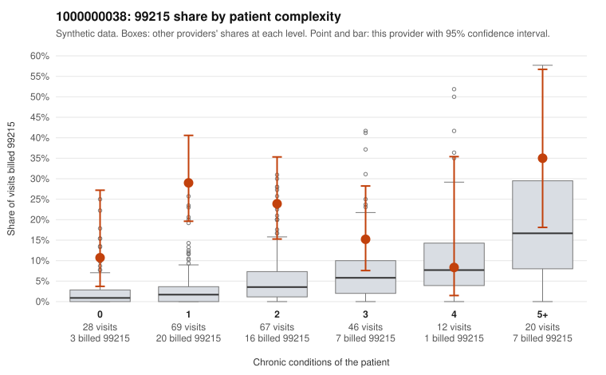

# 1000000038: 1000000038: 5 of 7 documented 99215 claims (71%) are documented below the billed level

**Leaning (advisory):** Pattern consistent with upcoding

## Why

1000000038 billed 99215 on 22.3% of 242 claims against an expected 4.2% given patient complexity (risk-adjusted score 5.45; plain z-score vs peers 2.83). 43% of this provider's 99215 claims were on patients with 0 or 1 chronic conditions. Records came back for 30 claims. Of 7 documented 99215 claims, 5 (71%) were documented below the billed level, against 0% for the comparison providers. 1 of 16 notes claiming moderate-or-higher data reviewed had no lab or test line on the claim. This pattern is consistent with upcoding. It is a reason to review the records, not a finding. Examples: C0025510: billed 99215, patient aged 28 with 0 chronic condition(s); documented MDM level moderate, minutes not recorded. C0025523: billed 99215, patient aged 24 with 1 chronic condition(s) (obesity); documented MDM level moderate, 34 minutes. C0025589: billed 99215, patient aged 57 with 1 chronic condition(s) (type 2 diabetes); documented MDM level moderate, 38 minutes. C0025459: billed 99215, patient aged 70 with 1 chronic condition(s) (obesity). C0025492: billed 99215, patient aged 78 with 1 chronic condition(s) (obesity).

## Evidence chart

## Cited claims

`C0025510`, `C0025523`, `C0025589`, `C0025459`, `C0025492`

## Suggested next steps

- Request the full records for the cited claims and have a certified coder re-score each against current E/M documentation rules (medical decision making or total time).
- If the re-scoring confirms the pattern, use the sampling plan in the recovery packet to review a statistical sample of this provider's 99215 claims.
- Check whether notes for the cited claims look copied forward, and whether documented minutes repeat from visit to visit.

---
Citations checked: 5/5 valid. Synthetic data. The leaning is advisory; the flag comes from the statistical screen, and no clinical documentation is available beyond the sampled records-review facts shown in the packet.
