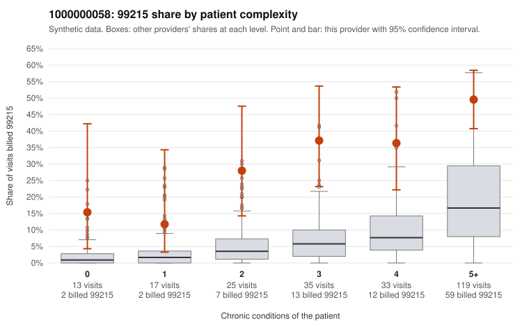

# 1000000058: 1000000058: 7 of 13 documented 99215 claims (54%) are documented below the billed level

**Leaning (advisory):** Pattern consistent with upcoding

## Why

1000000058 billed 99215 on 39.3% of 242 claims against an expected 10.2% given patient complexity (risk-adjusted score 5.79; plain z-score vs peers 5.65). 4% of this provider's 99215 claims were on patients with 0 or 1 chronic conditions. Records came back for 30 claims. Of 13 documented 99215 claims, 7 (54%) were documented below the billed level, against 0% for the comparison providers. 2 of 24 notes claiming moderate-or-higher data reviewed had no lab or test line on the claim. This pattern is consistent with upcoding. It is a reason to review the records, not a finding. Examples: C0034797: billed 99215; documented MDM level moderate, 33 minutes. C0034819: billed 99215; documented MDM level moderate, minutes not recorded. C0034884: billed 99215; documented MDM level moderate, 38 minutes. C0034781: billed 99215, patient aged 54 with 0 chronic condition(s). C0034821: billed 99215, patient aged 52 with 0 chronic condition(s). C0034848: billed 99215, patient aged 45 with 1 chronic condition(s) (hypothyroidism).

## Evidence chart

## Cited claims

`C0034797`, `C0034819`, `C0034884`, `C0034781`, `C0034821`, `C0034848`

## Suggested next steps

- Request the full records for the cited claims and have a certified coder re-score each against current E/M documentation rules (medical decision making or total time).
- If the re-scoring confirms the pattern, use the sampling plan in the recovery packet to review a statistical sample of this provider's 99215 claims.
- Check whether notes for the cited claims look copied forward, and whether documented minutes repeat from visit to visit.

---
Citations checked: 6/6 valid. Synthetic data. The leaning is advisory; the flag comes from the statistical screen, and no clinical documentation is available beyond the sampled records-review facts shown in the packet.
