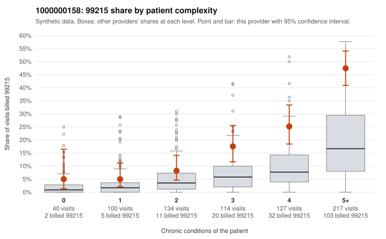

# 1000000158: Provider 1000000158 bills 99215 at about three times the risk-adjusted expectation, but the excess is concentrated in multi-morbid patients and the thin documentation sample does not contradict the billed levels.

**Leaning (advisory):** Inconclusive

## Why

1000000158 billed 99215 on 23.6% of 732 claims against an expected 7.8% given patient complexity (risk-adjusted score 6.22; plain z-score vs peers 3.05). 4% of this provider's 99215 claims were on patients with 0 or 1 chronic conditions. Records came back for 30 claims. Of 3 documented 99215 claims, 0 (0%) were documented below the billed level, against 0% for the comparison providers. 0 of 22 notes claiming moderate-or-higher data reviewed had no lab or test line on the claim. The 99215 share rises steeply with condition count, and most 99215 claims fall on patients with four or more chronic conditions (e.g., C0086184, C0086638). Only a small share fall on 0–1 condition patients, which is closer to a complex-panel pattern than to indiscriminate upcoding. However, the provider's share exceeds the all-provider rate at every complexity level, including low-complexity visits such as C0086547 (acute URI, no chronic conditions) and C0086619 (follow-up only). So patient mix alone may not explain the full excess. The three documented 99215 claims (C0086244, C0086324, C0086658) supported high MDM, and no notes showed data-review inflation without a test line. Still, three charts is far too thin to confirm or rule out upcoding, and the heavy 99214 volume is also worth noting. A reviewer should first request records for the sampled low-complexity 99215 claims, then pull a larger random sample of 99215 charts to test whether high MDM holds up beyond these three. Examples: C0086441: billed 99214; documented MDM level low, minutes not recorded. C0086104: billed 99215, patient aged 36 with 1 chronic condition(s) (obesity). C0086399: billed 99215, patient aged 29 with 1 chronic condition(s) (type 2 diabetes).

## Evidence chart

## Cited claims

`C0086441`, `C0086104`, `C0086399`

## Suggested next steps

- Request records for a larger sample of this provider's 99214 and 99215 claims; what came back is too thin to judge.
- Re-screen the provider once the records arrive.

---
Citations checked: 3/3 valid. Synthetic data. The leaning is advisory; the flag comes from the statistical screen, and no clinical documentation is available beyond the sampled records-review facts shown in the packet.
