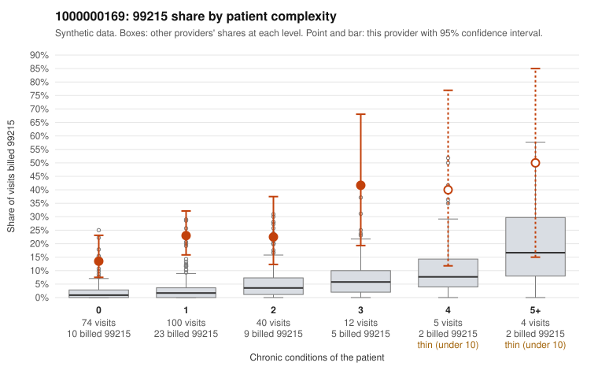

# 1000000169: 1000000169: 6 of 17 documented 99214 and 99215 claims (35%) are documented below the billed level

**Leaning (advisory):** Pattern consistent with upcoding

## Why

1000000169 billed 99215 on 21.7% of 235 claims against an expected 2.4% given patient complexity (risk-adjusted score 7.55; plain z-score vs peers 2.73). 65% of this provider's 99215 claims were on patients with 0 or 1 chronic conditions. Records came back for 30 claims. Of 3 documented 99215 claims, 3 (100%) were documented below the billed level, against 0% for the comparison providers. 2 of 11 notes claiming moderate-or-higher data reviewed had no lab or test line on the claim. This pattern is consistent with upcoding. It is a reason to review the records, not a finding. Examples: C0094133: billed 99215, patient aged 64 with 0 chronic condition(s); documented MDM level moderate, 35 minutes. C0094220: billed 99215, patient aged 31 with 1 chronic condition(s) (hypertension); documented MDM level moderate, 37 minutes. C0094370: billed 99215; documented MDM level moderate, minutes not recorded. C0094129: billed 99215, patient aged 64 with 1 chronic condition(s) (hypertension). C0094137: billed 99215, patient aged 37 with 1 chronic condition(s) (hyperlipidemia).

## Evidence chart

## Cited claims

`C0094133`, `C0094220`, `C0094370`, `C0094129`, `C0094137`

## Suggested next steps

- Request the full records for the cited claims and have a certified coder re-score each against current E/M documentation rules (medical decision making or total time).
- If the re-scoring confirms the pattern, use the sampling plan in the recovery packet to review a statistical sample of this provider's 99215 claims.
- Check whether notes for the cited claims look copied forward, and whether documented minutes repeat from visit to visit.

---
Citations checked: 5/5 valid. Synthetic data. The leaning is advisory; the flag comes from the statistical screen, and no clinical documentation is available beyond the sampled records-review facts shown in the packet.
