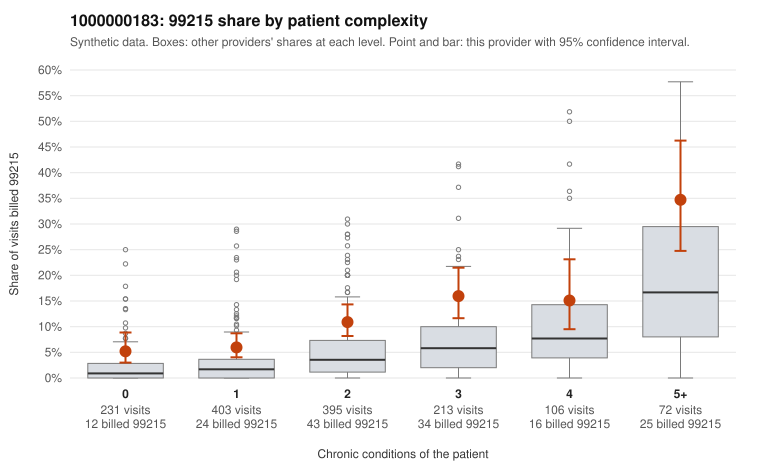

# 1000000183: Provider 1000000183 bills 99215 at roughly three times the risk-adjusted expectation in every complexity band, but the documentation sample is too thin to separate upcoding from a complex panel.

**Leaning (advisory):** Inconclusive

## Why

1000000183 billed 99215 on 10.8% of 1,420 claims against an expected 3.7% given patient complexity (risk-adjusted score 5.46; plain z-score vs peers 0.93). 23% of this provider's 99215 claims were on patients with 0 or 1 chronic conditions. Records came back for 30 claims. Of 5 documented 99215 claims, 1 (20%) were documented below the billed level, against 0% for the comparison providers. 3 of 25 notes claiming moderate-or-higher data reviewed had no lab or test line on the claim. The elevated 99215 share appears in every complexity band, including patients with zero or one chronic condition. Sampled low-complexity 99215 claims carry simple diagnoses such as UTI (C0103924), upper respiratory infection (C0103950) and back pain (C0104665), which is the pattern most consistent with upcoding. Against that, sampled high-complexity 99215s (C0104442, C0104748) are on genuinely multimorbid patients and were documented as high MDM, as was low-complexity claim C0104546. Only one documented 99215 (C0104871, moderate MDM) fell below the billed level. With just 5 documented 99215 claims, the unsupported rate cannot be trusted, and the few data-reviewed notes lacking a lab or test line are only weak evidence of inflated notes. A reviewer should first request charts specifically for the low-complexity 99215 claims listed and check whether the MDM and time actually support level 5 for single acute or simple diagnoses. Examples: C0104871: billed 99215; documented MDM level moderate, minutes not recorded. C0103924: billed 99215, patient aged 33 with 0 chronic condition(s). C0103950: billed 99215, patient aged 41 with 0 chronic condition(s).

## Evidence chart

## Cited claims

`C0104871`, `C0103924`, `C0103950`

## Suggested next steps

- Request records for a larger sample of this provider's 99214 and 99215 claims; what came back is too thin to judge.
- Re-screen the provider once the records arrive.

---
Citations checked: 3/3 valid. Synthetic data. The leaning is advisory; the flag comes from the statistical screen, and no clinical documentation is available beyond the sampled records-review facts shown in the packet.
