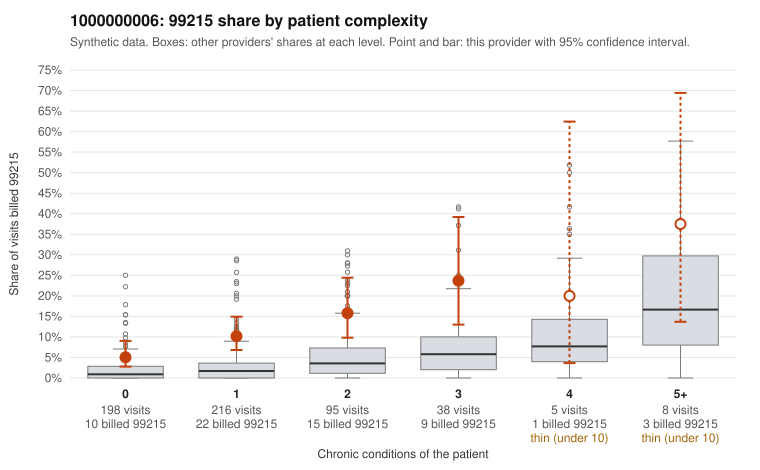

# 1000000006: 1000000006: too few returned records to judge

**Leaning (advisory):** Inconclusive

## Why

1000000006 billed 99215 on 10.7% of 560 claims against an expected 2.3% given patient complexity (risk-adjusted score 5.13; plain z-score vs peers 0.91). 53% of this provider's 99215 claims were on patients with 0 or 1 chronic conditions. Records came back for 45 claims. Of 17 documented 99215 claims, 1 (6%) were documented below the billed level, against 0% for the comparison providers. Note checks on 45 returned notes (share showing each sign): problems 29%, late 4%, unsigned 0%, data 4%. No audit trail was received. 2 of 38 notes claiming moderate-or-higher data reviewed had no lab or test line on the claim. The evidence does not support a call either way yet. Examples: C0005117: billed 99215; documented MDM level moderate, 38 minutes. C0004975: billed 99215, patient aged 26 with 0 chronic condition(s). C0005024: billed 99215, patient aged 42 with 1 chronic condition(s) (chronic kidney disease).

## Evidence chart

## Cited claims

`C0005117`, `C0004975`, `C0005024`

## Suggested next steps

- 45 charts came back but do not settle it: request a targeted sample of 99215 charts, starting with C0005117, C0004975, C0005024.
- Re-check after the targeted charts arrive; do not call upcoding or a sicker panel on this evidence alone.

---
Citations checked: 3/3 valid. Synthetic data. The leaning is advisory; the flag comes from the statistical screen, and no clinical documentation is available beyond the sampled records-review facts shown in the packet.
