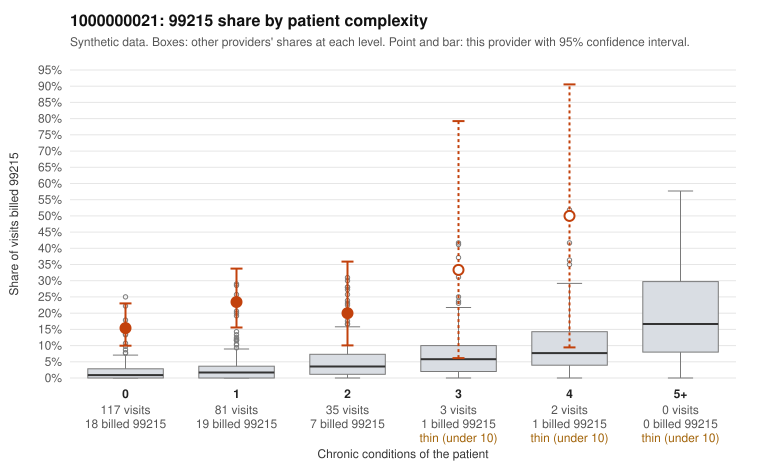

# 1000000021: 1000000021: 0 of 19 documented 99215 claims (0%) are documented below the billed level

**Leaning (advisory):** Pattern consistent with upcoding

## Why

1000000021 billed 99215 on 19.3% of 238 claims against an expected 1.8% given patient complexity (risk-adjusted score 7.91; plain z-score vs peers 2.34). 80% of this provider's 99215 claims were on patients with 0 or 1 chronic conditions. Records came back for 44 claims. Of 19 documented 99215 claims, 0 (0%) were documented below the billed level, against 0% for the comparison providers. Note checks on 44 returned notes (share showing each sign): problems 50%, late 18%, unsigned 0%, data 18%, bulk created 0%, paste heavy 4%. 8 of 35 notes claiming moderate-or-higher data reviewed had no lab or test line on the claim. This pattern is consistent with upcoding. It is a reason to review the records, not a finding. Examples: C0013199: billed 99215, patient aged 56 with 1 chronic condition(s) (atrial fibrillation). C0013202: billed 99215, patient aged 36 with 1 chronic condition(s) (asthma). C0013208: billed 99215, patient aged 24 with 0 chronic condition(s).

## Evidence chart

## Cited claims

`C0013199`, `C0013202`, `C0013208`

## Suggested next steps

- Request the full charts for C0013199, C0013202, C0013208 and have a certified coder re-score each against the current E/M rules (medical decision making or total time).
- If the re-scoring confirms the pattern, review the random sample in the recovery packet's sampling plan before any overpayment estimate; do not extrapolate from a targeted sample.
- Look at the notes themselves: 50% address fewer problems than their level implies and 18% were signed late; request the audit trail for C0013199, C0013202, C0013208.

---
Citations checked: 3/3 valid. Synthetic data. The leaning is advisory; the flag comes from the statistical screen, and no clinical documentation is available beyond the sampled records-review facts shown in the packet.
