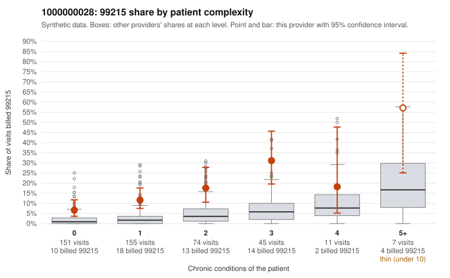

# 1000000028: Provider 1000000028 bills 99215 well above expectation in every complexity stratum, including many visits for 0–1 condition patients, but sampled charts largely support the billed level, while a high share of duplicated notes raises questions about whether that documentation can be relied on.

**Leaning (advisory):** Inconclusive

## Why

1000000028 billed 99215 on 13.8% of 443 claims against an expected 2.5% given patient complexity (risk-adjusted score 5.83; plain z-score vs peers 1.41). 46% of this provider's 99215 claims were on patients with 0 or 1 chronic conditions. Records came back for 45 claims. Of 16 documented 99215 claims, 1 (6%) were documented below the billed level, against 0% for the comparison providers. Note checks on 45 returned notes (share showing each sign): problems 29%, late 2%, unsigned 0%, data 4%. No audit trail was received. 3 of 30 notes claiming moderate-or-higher data reviewed had no lab or test line on the claim. The 99215 excess does not come from a sicker panel. The share runs roughly three to four times the all-provider rate in each condition band, and the low-complexity sample includes 99215s for single-problem diagnoses such as J06.9 (C0019013, C0019032), N39.0 (C0019064, C0019128) and Z09 follow-ups (C0019149, C0019159). The documentation points the other way: nearly all documented 99215s were supported, and the one mismatch (C0019149) was a Z09 follow-up. That support is weakened by the note signals. About two-thirds of returned notes were flagged as duplicates, there is no audit trail to show how the notes were created, and 'supported' examples such as C0019078 (obesity with R10.9) and C0019464 (hyperlipidemia alone) show high MDM on low-complexity patients. This pattern could reflect cloned or inflated notes rather than genuinely complex visits, but it is not proof. A reviewer should first pull the full notes for the documented low-complexity 99215s, compare duplicated text across patients, and request the EHR audit trail. Because records came back for only about a tenth of claims, more 99215 charts focused on the 0–1 condition patients would be needed before reaching a conclusion. Examples: C0019149: billed 99215, patient aged 36 with 0 chronic condition(s); documented MDM level moderate, 38 minutes. C0019013: billed 99215, patient aged 52 with 0 chronic condition(s). C0019032: billed 99215, patient aged 61 with 0 chronic condition(s).

## Evidence chart

## Cited claims

`C0019149`, `C0019013`, `C0019032`

## Suggested next steps

- 45 charts came back but do not settle it: request a targeted sample of 99215 charts, starting with C0019149, C0019013, C0019032.
- Re-check after the targeted charts arrive; do not call upcoding or a sicker panel on this evidence alone.

---
Citations checked: 3/3 valid. Synthetic data. The leaning is advisory; the flag comes from the statistical screen, and no clinical documentation is available beyond the sampled records-review facts shown in the packet.
