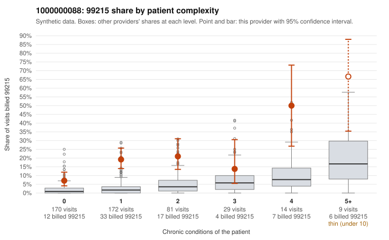

# 1000000088: Provider 1000000088 bills 99215 far above risk-adjusted expectation, much of it on 0–1 condition patients with routine diagnoses, but the few returned 99215 charts support the billed level, so the pattern is unresolved.

**Leaning (advisory):** Inconclusive

## Why

1000000088 billed 99215 on 16.6% of 475 claims against an expected 2.4% given patient complexity (risk-adjusted score 7.76; plain z-score vs peers 1.89). 57% of this provider's 99215 claims were on patients with 0 or 1 chronic conditions. Records came back for 30 claims. Of 6 documented 99215 claims, 0 (0%) were documented below the billed level, against 0% for the comparison providers. Note checks on 30 returned notes (share showing each sign): problems 37%, late 10%, unsigned 0%, data 0%, bulk created 0%, paste heavy 0%. 0 of 25 notes claiming moderate-or-higher data reviewed had no lab or test line on the claim. The claims pattern points toward upcoding. 99215 rates exceed the all-provider rate in every complexity band, and most 99215s fall on patients with zero or one chronic condition, many billed with routine diagnoses such as urinary infection, upper respiratory infection or follow-up visits (e.g., C0047837, C0048004, C0048018, C0048213). The documentation points the other way: every documented 99215 was supported at high MDM (e.g., C0048101, C0048189), and no notes claimed moderate-or-higher data review without a matching lab or test line. However, only six 99215 charts came back, too few to offset the claim-level signal, and C0048309 has no recorded time. The note signals are also ambiguous: the problems rate is notable, and repeated times and duplicates suggest possible templating. A reviewer should first request charts for the sampled low-complexity 99215 claims and check whether high MDM is genuinely supported for single acute complaints, then review the flagged problem notes (C0047813, C0047819, C0047831) for cloned or templated content. Examples: C0048143: billed 99214; documented MDM level low, 20 minutes. C0047825: billed 99215, patient aged 72 with 1 chronic condition(s) (obesity). C0047837: billed 99215, patient aged 32 with 0 chronic condition(s).

## Evidence chart

## Cited claims

`C0048143`, `C0047825`, `C0047837`

## Suggested next steps

- 30 charts came back but do not settle it: request a targeted sample of 99215 charts, starting with C0048143, C0047825, C0047837.
- Re-check after the targeted charts arrive; do not call upcoding or a sicker panel on this evidence alone.

---
Citations checked: 3/3 valid. Synthetic data. The leaning is advisory; the flag comes from the statistical screen, and no clinical documentation is available beyond the sampled records-review facts shown in the packet.
