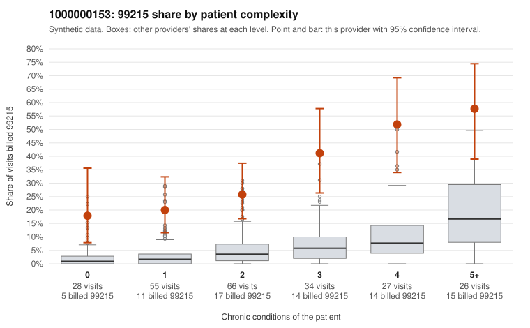

# 1000000153: Provider 1000000153's 99215 rate is elevated in every complexity tier, including patients with no chronic conditions; the few returned 99215 charts support the billed level, but note-quality signals hint at templating.

**Leaning (advisory):** Inconclusive

## Why

1000000153 billed 99215 on 32.2% of 236 claims against an expected 4.8% given patient complexity (risk-adjusted score 7.66; plain z-score vs peers 4.48). 21% of this provider's 99215 claims were on patients with 0 or 1 chronic conditions. Records came back for 30 claims. Of 10 documented 99215 claims, 0 (0%) were documented below the billed level, against 0% for the comparison providers. Note checks on 30 returned notes (share showing each sign): problems 20%, late 13%, unsigned 0%, data 7%. No audit trail was received. 3 of 20 notes claiming moderate-or-higher data reviewed had no lab or test line on the claim. The excess is not concentrated in sicker patients: the by-complexity table shows this provider's 99215 share running several times the all-provider share even for patients with 0 or 1 chronic conditions. Sampled low-complexity 99215s include C0084309 and C0084448, both for the same patient with no chronic conditions and an abdominal-pain code, and C0084436 for a depression-only patient whose 99214 claim C0084306 was documented at low MDM. Against this, all 10 documented 99215 claims (for example C0084268) supported the billed level, which points toward a complex panel. However, 10 charts is a thin base, and the duplicate and repeated-time rates, the problem flags, the missing audit trail and the 3 moderate-plus data-reviewed notes with no lab line leave open that notes were cloned or inflated to match billing. A reviewer should first pull charts for the low-complexity 99215 claims listed, starting with C0084309, C0084448 and C0084436. They should compare those notes against the documented high-complexity 99215s for copied text and repeated times, and request the EHR audit trail. Examples: C0084306: billed 99214, patient aged 38 with 1 chronic condition(s) (depression); documented MDM level low, minutes not recorded. C0084260: billed 99215, patient aged 49 with 1 chronic condition(s) (depression). C0084275: billed 99215, patient aged 45 with 1 chronic condition(s) (hypertension).

## Evidence chart

## Cited claims

`C0084306`, `C0084260`, `C0084275`

## Suggested next steps

- 30 charts came back but do not settle it: request a targeted sample of 99215 charts, starting with C0084306, C0084260, C0084275.
- Re-check after the targeted charts arrive; do not call upcoding or a sicker panel on this evidence alone.

---
Citations checked: 3/3 valid. Synthetic data. The leaning is advisory; the flag comes from the statistical screen, and no clinical documentation is available beyond the sampled records-review facts shown in the packet.
