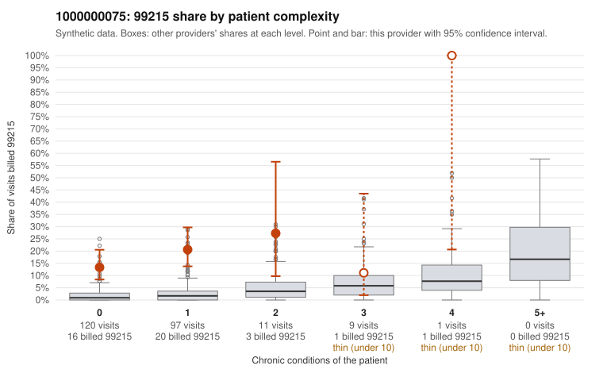

# Payment Integrity dossier: 1000000075

> Draft for human review. Statistical and records-sample evidence only; not a finding. Compliance or legal review is needed before any provider contact, notice or recoupment.

## Provider overview

| | |
|---|---|
| Specialty / state | Family Practice, GA (synthetic) |
| Claims / patients | 238 / 119 |
| Billed mix (99211 to 99215) | 7 / 3 / 80 / 107 / 41 |
| 99215 share | 17.2% |
| Expected 99215 share given patient complexity | 1.7% |
| Screen scores | z vs peers 1.99; risk-adjusted 7.15; flagged by suspicion>=5 |

## Case summary (advisory)

**1000000075: 3 of 6 documented 99215 claims (50%) are documented below the billed level**

Leaning: pattern consistent with upcoding. Citations checked: 5/5 valid.

1000000075 billed 99215 on 17.2% of 238 claims against an expected 1.7% given patient complexity (risk-adjusted score 7.15; plain z-score vs peers 1.99). 88% of this provider's 99215 claims were on patients with 0 or 1 chronic conditions. Records came back for 30 claims. Of 6 documented 99215 claims, 3 (50%) were documented below the billed level, against 0% for the comparison providers. Note checks on 30 returned notes (share showing each sign): problems 37%, late 3%, unsigned 0%, data 3%, bulk created 0%, paste heavy 0%. 2 of 19 notes claiming moderate-or-higher data reviewed had no lab or test line on the claim. This pattern is consistent with upcoding. It is a reason to review the records, not a finding. Examples: C0045080: billed 99215, patient aged 50 with 0 chronic condition(s); documented MDM level moderate, 36 minutes. C0045103: billed 99215, patient aged 72 with 0 chronic condition(s); documented MDM level moderate, 34 minutes. C0045320: billed 99215, patient aged 41 with 0 chronic condition(s); documented MDM level moderate, 21 minutes. C0045083: billed 99215, patient aged 40 with 0 chronic condition(s); documented MDM level high, 50 minutes. C0045088: billed 99215, patient aged 39 with 1 chronic condition(s) (type 2 diabetes).

## Evidence chart

## Records-review sample so far

Documentation is on file for 30 claims (13% of this provider's claims).

| Billed | Documented | Documentation below billed level | Rate | All-provider rate |
|---|---|---|---|---|
| 99213 | 12 | 0 | 0.0% | 1.2% |
| 99214 | 11 | 0 | 0.0% | 3.1% |
| 99215 | 6 | 3 | 50.0% | 0.0% |

## Recommended next steps for Payment Integrity

1. Request records for the sampled claims in `record_request_list.csv` (26 claims across 99215).
2. Review the records against E/M documentation rules and record the supported level for each claim.
3. Run the overpayment estimator on the reviewed sample (`sampling_plan.md` explains how).
4. Notice, appeal rights, recoupment, education or corrective action, and any referral are decisions for the PI team, compliance and counsel. Nothing here drafts those.

Suggested follow-ups from the case summary:

- Request the full charts for C0045080, C0045103, C0045320 and have a certified coder re-score each against the current E/M rules (medical decision making or total time).
- If the re-scoring confirms the pattern, review the random sample in the recovery packet's sampling plan before any overpayment estimate; do not extrapolate from a targeted sample.
- Look at the notes themselves: 37% address fewer problems than their level implies and 3% were signed late; request the audit trail for C0045080, C0045103, C0045320.

## Limits

- Synthetic data; no real claims or providers.
- The leaning is advisory. The flag comes from the statistical screen; the summary explains it.
- The records-review sample is partial and was simulated for this project.
- Allowed amounts are GA Family Practice averages from a public CMS file, not this provider's actual payments.
