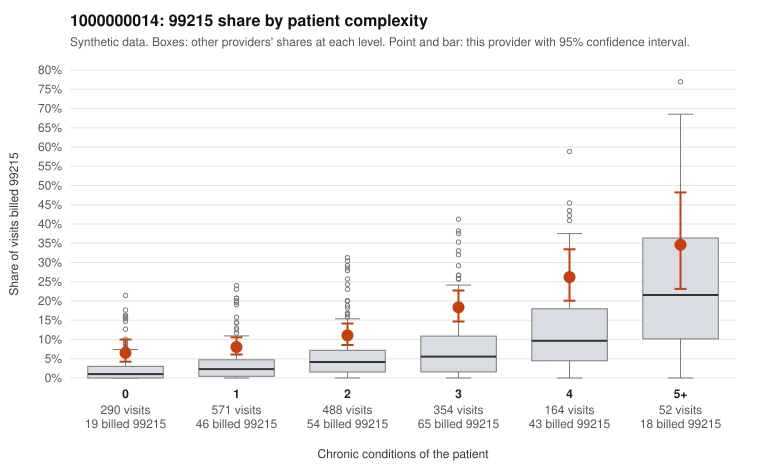

# 1000000014: Provider 1000000014 bills 99215 at roughly three times the risk-adjusted expectation in every complexity stratum, including low-complexity patients, but only one 99215 claim has documentation, so the records cannot confirm or rule out upcoding.

**Leaning (advisory):** Inconclusive

## Why

1000000014 billed 99215 on 12.8% of 1,919 claims against an expected 4.0% given patient complexity (risk-adjusted score 6.79; plain z-score vs peers 1.23). 27% of this provider's 99215 claims were on patients with 0 or 1 chronic conditions. Records came back for 30 claims. Of 1 documented 99215 claims, 0 (0%) were documented below the billed level, against 14% for the comparison providers. 3 of 15 notes claiming moderate-or-higher data reviewed had no lab or test line on the claim. The by-complexity table shows the elevated 99215 share is not explained by a sicker panel. The excess appears at every condition count, including the 0 and 1 condition groups. Sampled low-complexity 99215 claims sit on routine diagnoses such as UTI (C0009167), upper respiratory infection (C0009328), follow-up visits (C0009183, C0010234) and abdominal pain (C0010288), which is the pattern consistent with upcoding that warrants concern. The documentation does not settle the question: only one documented 99215 exists (C0010217, supported at high MDM), and the one below-billed note (C0010179) is a 99214. A few notes claiming moderate-or-higher data reviewed had no lab or test line on the claim, which is weak evidence of templated or inflated notes, not proof. A reviewer should first request charts specifically for the low-complexity 99215 claims listed in the packet, then check whether MDM and data-reviewed entries in those charts reflect actual work or cloned templates. Examples: C0010179: billed 99214; documented MDM level low, minutes not recorded. C0009167: billed 99215, patient aged 49 with 0 chronic condition(s). C0009180: billed 99215, patient aged 79 with 1 chronic condition(s) (hyperlipidemia).

## Evidence chart

## Cited claims

`C0010179`, `C0009167`, `C0009180`

## Suggested next steps

- Request records for a larger sample of this provider's 99214 and 99215 claims; what came back is too thin to judge.
- Re-screen the provider once the records arrive.

---
Citations checked: 3/3 valid. Synthetic data. The leaning is advisory; the flag comes from the statistical screen, and no clinical documentation is available beyond the sampled records-review facts shown in the packet.
