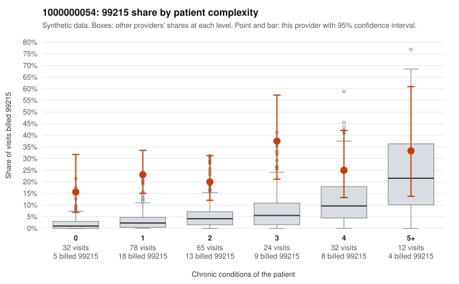

# 1000000054: Provider 1000000054 bills 99215 far above expectation in every complexity stratum, including many visits for patients with few or no chronic conditions, yet the small set of returned charts supports every billed level, so the evidence is mixed.

**Leaning (advisory):** Inconclusive

## Why

1000000054 billed 99215 on 23.5% of 243 claims against an expected 4.4% given patient complexity (risk-adjusted score 5.03; plain z-score vs peers 3.06). 40% of this provider's 99215 claims were on patients with 0 or 1 chronic conditions. Records came back for 30 claims. Of 9 documented 99215 claims, 0 (0%) were documented below the billed level, against 14% for the comparison providers. 6 of 29 notes claiming moderate-or-higher data reviewed had no lab or test line on the claim. The billing pattern points toward upcoding. The 99215 share exceeds the all-provider rate at every condition count, and is most elevated relative to peers among patients with 0 to 1 conditions. Several sampled 99215s carry only minor diagnoses such as URI, rash or follow-up codes (e.g., C0029289, C0029293, C0029322, C0029344, C0029369). Against that, none of the 9 documented 99215s fell below the billed level versus 14% for comparison providers, and the supported examples include a low-complexity visit (C0029248, single-condition asthma, documented high MDM at 45 minutes). The ambiguity is that 9 of 57 99215 claims is too thin a sample to clear the pattern. The 6 notes claiming moderate-or-higher data review with no lab or test line on the claim are weak evidence that documentation may be templated or inflated to match billing, not proof. A reviewer should first request charts for the low-complexity 99215s with minor diagnoses listed above and check those notes, and the 6 no-lab notes, for cloned or boilerplate MDM language. Examples: C0029214: billed 99215, patient aged 45 with 1 chronic condition(s) (COPD). C0029225: billed 99215, patient aged 18 with 1 chronic condition(s) (obesity).

## Evidence chart

## Cited claims

`C0029214`, `C0029225`

## Suggested next steps

- Request records for a larger sample of this provider's 99214 and 99215 claims; what came back is too thin to judge.
- Re-screen the provider once the records arrive.

---
Citations checked: 2/2 valid. Synthetic data. The leaning is advisory; the flag comes from the statistical screen, and no clinical documentation is available beyond the sampled records-review facts shown in the packet.
