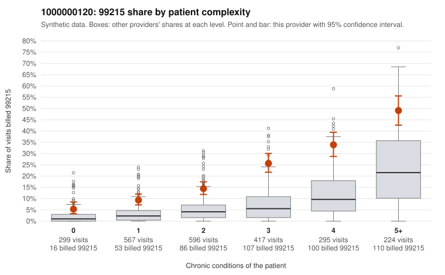

# 1000000120: Provider 1000000120 bills 99215 at elevated rates in every complexity band, including simple acute visits, but the few returned charts support the billed levels, so the evidence is mixed.

**Leaning (advisory):** Inconclusive

## Why

1000000120 billed 99215 on 19.7% of 2,398 claims against an expected 5.3% given patient complexity (risk-adjusted score 11.04; plain z-score vs peers 2.42). 15% of this provider's 99215 claims were on patients with 0 or 1 chronic conditions. Records came back for 30 claims. Of 6 documented 99215 claims, 0 (0%) were documented below the billed level, against 14% for the comparison providers. 7 of 26 notes claiming moderate-or-higher data reviewed had no lab or test line on the claim. The claims pattern leans toward upcoding. The 99215 share runs about two to two-and-a-half times the all-provider share in every complexity band, including patients with zero conditions, so a sicker panel alone does not explain it. The sampled low-complexity 99215s are mostly routine problems such as upper respiratory infection (C0059945, C0060092, C0061024), back pain (C0059908, C0060890), UTI (C0059940, C0060127) and follow-up encounters (C0060059, C0061022), which rarely need high-complexity decision-making. Against that, all 6 documented 99215 claims supported the billed level, with examples showing high MDM and 41-53 minutes (C0059529, C0060164), but 6 charts from 1.3% of claims is too thin to settle the question. The 7 notes claiming moderate-or-higher data review with no lab or test on the claim are weak evidence that notes may be templated or inflated to match billing. A reviewer should first pull charts for the sampled low-complexity 99215s, especially the zero-condition acute visits, and check them for cloned or templated note text. Examples: C0059458: billed 99215, patient aged 52 with 1 chronic condition(s) (hypothyroidism). C0059462: billed 99215, patient aged 48 with 0 chronic condition(s).

## Evidence chart

## Cited claims

`C0059458`, `C0059462`

## Suggested next steps

- Request records for a larger sample of this provider's 99214 and 99215 claims; what came back is too thin to judge.
- Re-screen the provider once the records arrive.

---
Citations checked: 2/2 valid. Synthetic data. The leaning is advisory; the flag comes from the statistical screen, and no clinical documentation is available beyond the sampled records-review facts shown in the packet.
