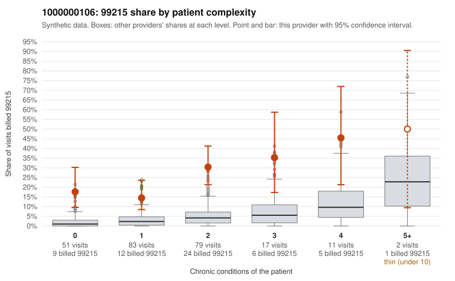

# Payment Integrity dossier: 1000000106

> Draft for human review. Statistical and records-sample evidence only; not a finding. Compliance or legal review is needed before any provider contact, notice or recoupment.

## Provider overview

| | |
|---|---|
| Specialty / state | Family Practice, GA (synthetic) |
| Claims / patients | 243 / 120 |
| Billed mix (99211 to 99215) | 1 / 0 / 63 / 122 / 57 |
| 99215 share | 23.5% |
| Expected 99215 share given patient complexity | 3.1% |
| Screen scores | z vs peers 3.06; risk-adjusted 6.30; flagged by suspicion>=5 |

## Case summary (advisory)

**1000000106: 14 of 23 documented 99214 and 99215 claims (61%) are documented below the billed level**

Leaning: pattern consistent with upcoding. Citations checked: 5/5 valid.

1000000106 billed 99215 on 23.5% of 243 claims against an expected 3.1% given patient complexity (risk-adjusted score 6.30; plain z-score vs peers 3.06). 37% of this provider's 99215 claims were on patients with 0 or 1 chronic conditions. Records came back for 30 claims. Of 5 documented 99215 claims, 4 (80%) were documented below the billed level, against 14% for the comparison providers. 1 of 11 notes claiming moderate-or-higher data reviewed had no lab or test line on the claim. This pattern is consistent with upcoding. It is a reason to review the records, not a finding. Examples: C0051986: billed 99215, patient aged 82 with 0 chronic condition(s); documented MDM level moderate, 32 minutes. C0052042: billed 99215, patient aged 46 with 1 chronic condition(s) (type 2 diabetes); documented MDM level moderate, 35 minutes. C0052190: billed 99215; documented MDM level moderate, 36 minutes. C0051980: billed 99215, patient aged 51 with 0 chronic condition(s). C0051985: billed 99215, patient aged 49 with 0 chronic condition(s).

## Evidence chart

## Records-review sample so far

Documentation is on file for 30 claims (12% of this provider's claims).

| Billed | Documented | Documentation below billed level | Rate | All-provider rate |
|---|---|---|---|---|
| 99213 | 7 | 0 | 0.0% | 3.9% |
| 99214 | 18 | 10 | 55.6% | 2.5% |
| 99215 | 5 | 4 | 80.0% | 14.3% |

## Recommended next steps for Payment Integrity

1. Request records for the sampled claims in `record_request_list.csv` (32 claims across 99215).
2. Review the records against E/M documentation rules and record the supported level for each claim.
3. Run the overpayment estimator on the reviewed sample (`sampling_plan.md` explains how).
4. Notice, appeal rights, recoupment, education or corrective action, and any referral are decisions for the PI team, compliance and counsel. Nothing here drafts those.

Suggested follow-ups from the case summary:

- Request the full records for the cited claims and have a certified coder re-score each against current E/M documentation rules (medical decision making or total time).
- If the re-scoring confirms the pattern, use the sampling plan in the recovery packet to review a statistical sample of this provider's 99215 claims.
- Check whether notes for the cited claims look copied forward, and whether documented minutes repeat from visit to visit.

## Limits

- Synthetic data; no real claims or providers.
- The leaning is advisory. The flag comes from the statistical screen; the summary explains it.
- The records-review sample is partial and was simulated for this project.
- Allowed amounts are GA Family Practice averages from a public CMS file, not this provider's actual payments.
