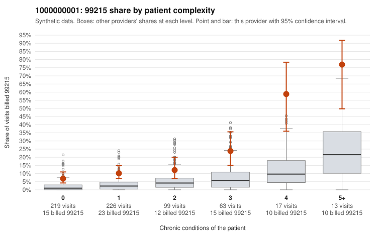

# 1000000001: Provider 1000000001 bills 99215 well above expectation in every complexity band, including many low-complexity visits, yet every returned 99215 chart supports the billed level, and several note signals raise questions about whether that documentation reflects the visits.

**Leaning (advisory):** Inconclusive

## Why

1000000001 billed 99215 on 13.3% of 637 claims against an expected 2.9% given patient complexity (risk-adjusted score 5.45; plain z-score vs peers 1.33). 45% of this provider's 99215 claims were on patients with 0 or 1 chronic conditions. Records came back for 45 claims. Of 19 documented 99215 claims, 0 (0%) were documented below the billed level, against 14% for the comparison providers. Note checks on 45 returned notes (share showing each sign): problems 22%, late 0%, unsigned 0%, data 7%. No audit trail was received. 5 of 35 notes claiming moderate-or-higher data reviewed had no lab or test line on the claim. The elevated 99215 share appears even in the 0- and 1-condition bands, which is the core upcoding concern; a sicker panel alone would not explain high-level billing on visits like an upper respiratory infection (C0000046, C0000174) or follow-ups coded Z09 (C0000099, C0000419). Against that, all documented 99215 claims supported the billed level. That is cleaner than the comparison rate and even below the small mismatch expected from noisy honest documentation, so on its face it is consistent with real complexity. Part of that support looks fragile: claims documented at high MDM include low-complexity visits with no time recorded (C0000032, C0000174, C0000566), and C0000032 and C0000174 also appear among the problem-flag examples. The repeated-time rate and the moderate-plus data claims with no lab or test line are weak signs of templated or inflated notes, not proof. Reviewers should first read the full notes for the low-complexity 99215 claims that were documented as supported, checking whether the MDM elements fit the diagnosis. They should also request the missing audit trail and more charts, since only a small share of claims was documented. Examples: C0000012: billed 99215, patient aged 44 with 1 chronic condition(s) (hyperlipidemia). C0000032: billed 99215, patient aged 29 with 1 chronic condition(s) (hypertension); documented MDM level high, minutes not recorded.

## Evidence chart

## Cited claims

`C0000012`, `C0000032`

## Suggested next steps

- 45 charts came back but do not settle it: request a targeted sample of 99215 charts, starting with C0000012, C0000032.
- Re-check after the targeted charts arrive; do not call upcoding or a sicker panel on this evidence alone.

---
Citations checked: 2/2 valid. Synthetic data. The leaning is advisory; the flag comes from the statistical screen, and no clinical documentation is available beyond the sampled records-review facts shown in the packet.
