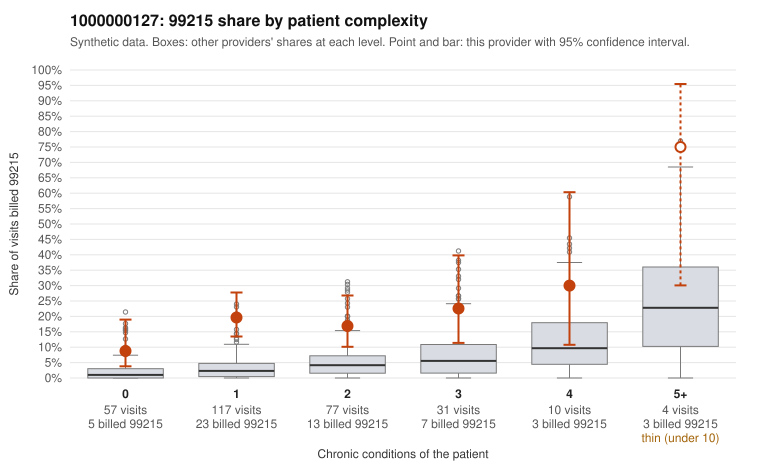

# 1000000127: Provider 1000000127 bills 99215 well above expectation in every complexity band, including many low-complexity patients, but the few documented 99215 charts support the billed level, so the record is too thin to resolve the question.

**Leaning (advisory):** Inconclusive

## Why

1000000127 billed 99215 on 18.2% of 296 claims against an expected 3.2% given patient complexity (risk-adjusted score 5.15; plain z-score vs peers 2.17). 52% of this provider's 99215 claims were on patients with 0 or 1 chronic conditions. Records came back for 30 claims. Of 6 documented 99215 claims, 0 (0%) were documented below the billed level, against 14% for the comparison providers. Note checks on 30 returned notes (share showing each sign): problems 27%, late 13%, unsigned 0%, data 7%. No audit trail was received. 3 of 24 notes claiming moderate-or-higher data reviewed had no lab or test line on the claim. The elevated 99215 share appears in every condition-count band, and about half of the 99215s fall on patients with 0 or 1 chronic conditions, often with routine diagnoses such as J06.9, N39.0 or Z09 (e.g., C0066596, C0066755, C0066760), which is a pattern consistent with upcoding rather than a sicker panel. Against that, all 6 documented 99215 claims were supported, but 6 charts is too few to offset the billing signal, and some supported notes carry warning signs of their own. C0066472 is documented as high MDM on a patient with no chronic conditions and a Z09 follow-up diagnosis, and the same note is flagged for problem-list and late-entry issues. The repeated-time and duplicate note signals, the 3 moderate-plus data notes with no lab or test line, and the missing audit trail all leave open whether notes were cloned or inflated to match the billed level. A reviewer should first request charts and audit trails for the low-complexity 99215 claims listed, then compare documented MDM against the diagnoses billed and check note creation timing. Examples: C0066502: billed 99214; documented MDM level low, minutes not recorded. C0066472: billed 99215, patient aged 56 with 0 chronic condition(s); documented MDM level high, minutes not recorded. C0066479: billed 99215, patient aged 33 with 1 chronic condition(s) (COPD).

## Evidence chart

## Cited claims

`C0066502`, `C0066472`, `C0066479`

## Suggested next steps

- 30 charts came back but do not settle it: request a targeted sample of 99215 charts, starting with C0066502, C0066472, C0066479.
- Re-check after the targeted charts arrive; do not call upcoding or a sicker panel on this evidence alone.

---
Citations checked: 3/3 valid. Synthetic data. The leaning is advisory; the flag comes from the statistical screen, and no clinical documentation is available beyond the sampled records-review facts shown in the packet.
